# 🛠️ AutoNovel 商用化・公開前ハードニング 36ステップ詳細実装計画書

- **プロジェクト**: AutoNovel (`e:\autonovel`)
- **作成日**: 2026-10-14
- **バージョン目標**: v6.1.0（Commercial Production Ready）
- **前提条件**: 回帰テスト 344 件パス（0 fail）、テスト収集 9,877 件健全（エラー 0）

---

## 0. 基本方針と品質原則

1. **不具合クラスごとに回帰防止テストを先行作成（TDD / Ratchet 方式）**:
   - 修正前にまず「現在の穴を突く失敗テスト（赤）」を作成し、修正後に「緑」になることを証明する。
2. **所有権ガードの単一情報源化（Single Source of Truth）**:
   - 各ルーターでの独自インライン判定を全廃し、[`verify_book_ownership`](file:///e:/autonovel/src/backend/security/owner_guard.py#L22-L53) に集約。
3. **安全な段階的移行（Backward Compatible Migration）**:
   - リポジトリ統合などの大規模リファクタリングは、エイリアスと段階的非推奨化を挟み、一撃での破壊を防ぐ。
4. **毎フェーズ終了時の全回帰テスト実行**:
   - 各フェーズ（全6フェーズ）の終了時に `pytest tests/regression` を完走させ、回帰ゼロを維持する。

---

## 概要フローチャート

```mermaid
graph TD
    subgraph Phase 1: セキュリティ修正 & 所有権ガード統一
        S01[Step 1: NULL所有者バイパステスト作成] --> S02[Step 2: publishing.py 所有権ガード統一]
        S02 --> S03[Step 3: publishing.py 検証]
        S03 --> S04[Step 4: orchestrated.py 所有権ガード統一]
        S04 --> S05[Step 5: orchestrated.py 検証]
        S05 --> S06[Step 6: collab.py メンバー判定の user_id 化]
        S06 --> S07[Step 7: コラボ偽装防止テスト作成]
        S07 --> S08[Step 8: Phase 1 回帰検証]
    end

    subgraph Phase 2: 管理者 API 認可強化
        S08 --> S09[Step 9: 管理者API認可テスト作成]
        S09 --> S10[Step 10: system.py スキル切替API昇格]
        S10 --> S11[Step 11: system.py BookScore再計算昇格]
        S11 --> S12[Step 12: system.py サーキットブレーカー昇格]
        S12 --> S13[Step 13: system.py 残存管理者ルート見直し]
        S13 --> S14[Step 14: api_readonly 遮断テスト検証]
        S14 --> S15[Step 15: Phase 2 回帰検証]
    end

    subgraph Phase 3: BookRepository 二重定義統合
        S15 --> S16[Step 16: リポジトリ重複検出ゲート作成]
        S16 --> S17[Step 17: リポジトリAPI差分棚卸し]
        S17 --> S18[Step 18: infrastructure/book.py 互換補完]
        S18 --> S19[Step 19: generation_tasks 等の import 移行]
        S19 --> S20[Step 20: easy_mode / illustrations の移行]
        S20 --> S21[Step 21: 旧 BookRepository エイリアス化]
        S21 --> S22[Step 22: Phase 3 回帰検証]
    end

    subgraph Phase 4: パイプライン & エージェント品質
        S22 --> S23[Step 23: syntax_refiner 境界テスト追加]
        S23 --> S24[Step 24: 伏線自動設置コンテキスト検証]
        S24 --> S25[Step 25: 8専門オーディター耐障害テスト]
        S25 --> S26[Step 26: 執筆無限ループ脱出保証テスト]
        S26 --> S27[Step 27: Outbox ロールバック整合性テスト]
        S27 --> S28[Step 28: Phase 4 回帰検証]
    end

    subgraph Phase 5: フロントエンド堅牢化
        S28 --> S29[Step 29: 401 応答時トークンパージ検証]
        S29 --> S30[Step 30: SSE ストリーム再接続テスト]
        S30 --> S31[Step 31: HTTP エラー UI トースト表示改善]
        S31 --> S32[Step 32: TS 型と OpenAPI スキーマ突合]
        S32 --> S33[Step 33: Phase 5 Vitest 実行]
    end

    subgraph Phase 6: 総合監査 & リリース判定
        S33 --> S34[Step 34: 静的解析 ruff/mypy チェック]
        S34 --> S35[Step 35: 9,800+ テスト総合実行]
        S35 --> S36[Step 36: リリース判定 & ドキュメント更新]
    end
```



---

## 36ステップ詳細計画

### Phase 1: セキュリティ修正 & 所有権ガード統一（Steps 1 ~ 8）

#### Step 1: `test_no_null_owner_bypass.py` の作成
- **目的**: 所有者が NULL (`user_id is None`) の作品に対して、一般ユーザーがアクセスした際に確実に `403 Forbidden` が返ることを保証するゲートを作成。
- **実装内容**: `tests/regression/test_no_null_owner_bypass.py` を作成。
  - テスト対象: `/api/export/publish/{platform}`, `/api/orchestrated/export/{book_id}`
  - 前提: DB に `user_id=None` の `Book` を作成。
  - 検証: 一般ユーザーのトークンでアクセスした場合に 403、admin トークンでアクセスした場合にのみ許可されること。
- **受け入れ基準**: 現状の実装に対して実行した際に **FAIL（赤）** となること。

#### Step 2: `src/backend/routers/publishing.py` の所有権ガード統一
- **目的**: [`publishing.py:L28-39`](file:///e:/autonovel/src/backend/routers/publishing.py#L28-L39) のインライン判定を廃止。
- **実装内容**:
  ```python
  from src.backend.security.owner_guard import verify_book_ownership

  async def _verify_publish_access(db: AsyncSession, book_id: int, current_user: User) -> None:
      await verify_book_ownership(book_id, current_user, db)
  ```
- **受け入れ基準**: 独自ロジックを全廃し、所有者 NULL の作品に対する非管理者リクエストが 403 となること。

#### Step 3: `publishing.py` の検証テスト実行
- **目的**: Step 2 の修正により Step 1 の publishing 向けテストが緑になることを確認。
- **コマンド**: `pytest tests/regression/test_no_null_owner_bypass.py -k "publishing"`
- **受け入れ基準**: 対象テストが PASS すること。

#### Step 4: `src/backend/routers/orchestrated.py` の所有権ガード統一
- **目的**: [`orchestrated.py:L201-208`](file:///e:/autonovel/src/backend/routers/orchestrated.py#L201-L208) の `export_orchestrated_package` を修正。
- **実装内容**:
  - インライン判定 `getattr(book, "user_id", None) is not None` を削除。
  - `await verify_book_ownership(book_id, current_user, session)` を呼び出す形に置換。
- **受け入れ基準**: 非所有者・NULL 所有者作品の ZIP エクスポートが 403 で遮断されること。

#### Step 5: `orchestrated.py` の検証テスト実行
- **目的**: Step 4 の修正により Step 1 の orchestrated 向けテストが緑になることを確認。
- **コマンド**: `pytest tests/regression/test_no_null_owner_bypass.py -k "orchestrated"`
- **受け入れ基準**: Step 1 の全テストが PASS すること。

#### Step 6: `src/backend/routers/collab.py` のコラボメンバー判定の `user_id` 化
- **目的**: 表示名（`display_name`）の一致判定によるなりすまし脆弱性を排除。
- **対象箇所**: [`collab.py:L54-63`](file:///e:/autonovel/src/backend/routers/collab.py#L54-L63) の `_verify_book_access`
- **実装内容**:
  - `members = await uow.collab.list_members(book_id)` から取得するメンバー情報について、`m.user_id` を用いて `current_user.id in member_user_ids` で照合。
  - `CollabMember` モデルに `user_id` が存在することを確認し、なければマイグレーションまたは紐付けを補正。
- **受け入れ基準**: 異なる `user_id` を持ち同名の `display_name` を設定した攻撃ユーザーが 403 で拒否されること。

#### Step 7: コラボ偽装防止単体テスト（`test_collab_spoofing_prevented.py`）作成
- **目的**: 表示名なりすまし攻撃の回帰防止テストを作成。
- **実装内容**: `tests/unit/backend/test_collab_spoofing_prevented.py`
  - 被害者ユーザー（メンバー登録済み）と同一の `display_name` を持つ攻撃者ユーザーを作成。
  - 攻撃者がコラボレーション作品の取得・コメント解決を試み、確実に 403 となることを assert。
- **受け入れ基準**: テストが PASS すること。

#### Step 8: Phase 1 回帰検証
- **コマンド**: `pytest tests/regression/test_no_null_owner_bypass.py tests/unit/backend/test_collab_spoofing_prevented.py tests/regression`
- **受け入れ基準**: 全テスト（344 + 新規）が 1 件の失敗もなく PASS すること。

---

### Phase 2: 管理者 API 認可強化 & IDOR 多層防御（Steps 9 ~ 15）

#### Step 9: `test_admin_endpoints_require_admin_role.py` の作成
- **目的**: 管理者向け API に一般 API キーでアクセスした際、403 で遮断されることを検証するゲート。
- **実装内容**: `tests/regression/test_admin_endpoints_require_admin_role.py`
  - `/api/system/admin/skills/switch_version`
  - `/api/system/admin/book_score/recalc`
  - `/admin/llm/circuit-breaker/reset`
- **受け入れ基準**: 現状の実装に対して実行した際に **FAIL（赤）** となること。

#### Step 10: `system.py` の `switch_skill_version` 認可昇格
- **対象コード**: [`system.py:L130`](file:///e:/autonovel/src/backend/routers/system.py#L130)
- **修正内容**: `dependencies=[Depends(require_api_key)]` → `dependencies=[Depends(require_admin_user_or_key)]` に変更。
- **受け入れ基準**: admin ロールを持つユーザーまたは正規の admin API キーでのみ実行可能となること。

#### Step 11: `system.py` の `recalc_all_book_scores` 認可昇格
- **対象コード**: [`system.py:L158`](file:///e:/autonovel/src/backend/routers/system.py#L158)
- **修正内容**: `dependencies=[Depends(require_api_key)]` → `dependencies=[Depends(require_admin_user_or_key)]` に変更。
- **受け入れ基準**: 一般ユーザーや読み取り専用 API キーでの負荷の高い一括再計算呼び出しを防止できること。

#### Step 12: `system.py` のサーキットブレーカー操作 API 認可昇格
- **対象コード**: [`system.py:L103`](file:///e:/autonovel/src/backend/routers/system.py#L103)
- **修正内容**: `/admin/llm/circuit-breaker/reset` の依存性を `require_admin_user_or_key` に昇格。
- **受け入れ基準**: サービス停止を招く恐れのあるサーキットブレーカーの任意リセットが管理者に限定されること。

#### Step 13: `system.py` 残存管理者ルートの点検と修正
- **対象コード**: [`system.py:L97`](file:///e:/autonovel/src/backend/routers/system.py#L97) `/admin/llm/providers/status` 等
- **修正内容**: 管理者専用ルートをすべて `require_admin_user_or_key` に統一。
- **受け入れ基準**: `grep "require_api_key" src/backend/routers/system.py` で管理者系ルートが残っていないこと。

#### Step 14: `api_readonly` キー遮断テストの検証
- **目的**: [`auth.py:L140`](file:///e:/autonovel/src/backend/auth.py#L140) の `api_readonly` ロール付与が正しく機能し、管理者 API 呼び出し時に 403 となることを確認。
- **コマンド**: `pytest tests/regression/test_admin_endpoints_require_admin_role.py`
- **受け入れ基準**: 全テストが PASS すること。

#### Step 15: Phase 2 回帰検証
- **コマンド**: `pytest tests/regression -k "admin or auth"`
- **受け入れ基準**: 既存の認証契約テスト（`test_auth_bypass_contract.py`）を含めすべて正常終了すること。

---

### Phase 3: `BookRepository` 二重定義の統合 & DB セッション健全化（Steps 16 ~ 22）

#### Step 16: `test_no_duplicate_repository_classes.py` の作成
- **目的**: 同一プロジェクト内に同名のリポジトリクラスが複数定義される構造的劣化を防止する AST 検査ゲート。
- **実装内容**: `src/` 配下の全 `.py` ファイルを走査し、`class BookRepository` が 1 箇所のみ定義されていること（またはエイリアスであること）を検証。
- **受け入れ基準**: 現状の実装に対して実行した際に **FAIL（赤）** となること。

#### Step 17: リポジトリ API 差分の棚卸し
- **調査対象**:
  - [`src/infrastructure/repositories/book.py`](file:///e:/autonovel/src/infrastructure/repositories/book.py)
  - [`src/backend/database/repository.py`](file:///e:/autonovel/src/backend/database/repository.py)
- **作業内容**: メソッド名（`get_book`, `get_book_async`, `update_task_status_async` 等）、引数シグネチャ、戻り値の型を一覧化し、互換表を作成。
- **受け入れ基準**: 移行に必要な不足メソッド一覧が特定されていること。

#### Step 18: `src/infrastructure/repositories/book.py` への不足メソッド補完
- **実装内容**:
  - 旧 `BookRepository` で使われていた `update_task_status_async` や特定ヘルパーを、`BaseRepository` の規約に沿った形で [`src/infrastructure/repositories/book.py`](file:///e:/autonovel/src/infrastructure/repositories/book.py) に追加。
  - `AsyncSession` 前提に統一し、同期コンテキストでの `loop.create_task` ハックを排除。
- **受け入れ基準**: 単体テストで新メソッドの動作が確認できること。

#### Step 19: `generation_tasks.py` および `orchestrated.py` の import 移行
- **対象ファイル**:
  - `src/backend/tasks/generation_tasks.py`
  - `src/backend/routers/orchestrated.py`
- **修正内容**:
  ```diff
  -from src.backend.database.repository import BookRepository
  +from src.infrastructure.repositories.book import BookRepository
  ```
- **受け入れ基準**: 当該ファイルからの呼び出しがすべて正常に非同期 UoW 経由で動作すること。

#### Step 20: `easy_mode.py`、`export_service.py`、`illustrations.py` の import 移行
- **対象ファイル**: 残る 4 モジュールの import 参照先を `src.infrastructure.repositories.book` に置換。
- **受け入れ基準**: `grep -rn "from src.backend.database.repository import BookRepository" src/` のヒット件数が 0 件になること。

#### Step 21: `src/backend/database/repository.py` の旧クラスをエイリアス化
- **実装内容**:
  [`src/backend/database/repository.py`](file:///e:/autonovel/src/backend/database/repository.py) 内の `class BookRepository:` 実装を削除し、以下に置換:
  ```python
  from src.infrastructure.repositories.book import BookRepository  # noqa: F401
  ```
- **受け入れ基準**: Step 16 で作成した `test_no_duplicate_repository_classes.py` が PASS すること。

#### Step 22: Phase 3 回帰検証
- **コマンド**: `pytest tests/database tests/unit/backend tests/regression`
- **受け入れ基準**: DB 関連・UoW 関連のテストがすべて PASS すること。

---

### Phase 4: パイプライン & エージェント品質の強化（Steps 23 ~ 28）

#### Step 23: `syntax_refiner.py` の境界テスト追加
- **対象コード**: [`syntax_refiner.py:L73-85`](file:///e:/autonovel/src/services/anti_ai/syntax_refiner.py#L73-L85)
- **実装内容**: `tests/unit/services/test_syntax_refiner_boundary.py`
  - 文頭（「たぶん、彼は〜」）
  - 読点直後（「彼は、おそらく〜」）
  - カギ括弧会話文内（「『きっと大丈夫』と言った」）
  - 通常の単語内部分一致誤爆防止（「なくなる」「重なる」「かな」）
- **受け入れ基準**: 全パターンで意図通りの除去・保持が行われること。

#### Step 24: 伏線自動設置（`ForeshadowingRegistrationStep`）の動作検証
- **対象コード**: [`prompt_composer.py:L96-100`](file:///e:/autonovel/src/agents/prompt_composer.py#L96-L100)
- **実装内容**: `tests/unit/writing/test_foreshadowing_prompt_injection.py`
  - `context["foreshadowing_ctx"]` が存在する場合に、優先的にプロンプトセクションへ展開されることを検証。
- **受け入れ基準**: 伏線データがプロンプト内でロストしないこと。

#### Step 25: 8 専門オーディター耐障害テスト
- **対象コード**: [`src/agents/specialists/`](file:///e:/autonovel/src/agents/specialists/)
- **実装内容**: `tests/unit/agents/test_specialist_circuit_breaker.py`
  - 特定の専門オーディター（例: `multimodal_auditor`）が LLM レート制限やタイムアウトで失敗した際、システム全体が 500 でクラッシュせず、グレースフルに縮退（デフォルトスコア算出）して執筆を継続できることを検証。
- **受け入れ基準**: テストが PASS すること。

#### Step 26: 執筆無限ループ脱出保証テスト
- **対象コード**: [`orchestrator.py:L50-53`](file:///e:/autonovel/src/agents/orchestrator.py#L50-L53)
- **実装内容**: `tests/unit/workflows/test_writing_graph_retry.py` に、最大再試行回数（`MAX_RETRIES`）到達時に確実にユーザーレビュー待ち（`needs_review`）または現状ドラフト確定（`finalize`）へ遷移するテストケースを拡充。
- **受け入れ基準**: トポロジカル実行がデッドロックしないこと。

#### Step 27: Outbox パターンにおける SQLite ロールバック整合性テスト
- **対象コード**: [`uow.py:L59-60`](file:///e:/autonovel/src/backend/database/uow.py#L59-L60)
- **実装内容**: `tests/database/test_uow_outbox_rollback.py`
  - UoW コンテキスト内で例外が発生して SQLite セッションがロールバックされた際、ChromaDB への追加キュー（`_chroma_additions`）が破棄され、孤児ベクトルが残らないことを検証。
- **受け入れ基準**: テストが PASS すること。

#### Step 28: Phase 4 回帰検証
- **コマンド**: `pytest tests/unit/services tests/unit/agents tests/regression`
- **受け入れ基準**: パイプライン関連の全テストが PASS すること。

---

### Phase 5: フロントエンド堅牢化 & 通信・UX 改善（Steps 29 ~ 33）

#### Step 29: 401 応答時トークンパージ & 認証状態連携の検証
- **対象コード**: [`client.ts:L126-129`](file:///e:/autonovel/frontend/src/api/client.ts#L126-L129)
- **テスト内容**: `frontend/src/tests/apiClientAuth.test.ts`
  - 401 Unauthorized 受信時に `clearAuthToken()` が呼ばれ、localStorage の `auth_token` が確実に除去されることを検証。
- **受け入れ基準**: テストが PASS すること。

#### Step 30: SSE ストリーム再接続 & 中断テスト
- **対象コード**: `frontend/src/api/wizard.ts`
- **テスト内容**: ネットワーク瞬断時にブラウザ側で EventSource / fetch reader がクリーンアップされ、メモリリークや無限再接続ループが発生しないことを検証。
- **受け入れ基準**: Vitest でテストが PASS すること。

#### Step 31: HTTP エラー UI トースト表示改善
- **対象ファイル**: `frontend/src/pages/WizardWorkflowPage.tsx`, `StudioWorkspacePage.tsx`
- **実装内容**:
  - バックエンドから返却された 403（所有権エラー）や 400（バリデーションエラー）の `detail` 文字列をユーザーフレンドリーなトースト通知で確実に表示。
- **受け入れ基準**: エラー時に画面が真っ白にならず、適切なエラーメッセージが表示されること。

#### Step 32: TS 型定義とバックエンド OpenAPI スキーマ突合
- **コマンド**: `python scripts/generate_openapi.py --check` (または npm スクリプト)
- **作業内容**: フロントエンドの `frontend/src/types/api.ts` とバックエンドの OpenAPI スキーマ（`docs/openapi.json`）の型差分がないことを確認。
- **受け入れ基準**: 型の欠落やプロパティ名の食い違いが 0 件であること。

#### Step 33: Phase 5 Vitest 実行
- **コマンド**: `cd frontend && npm run test`
- **受け入れ基準**: フロントエンド全テストが PASS すること。

---

### Phase 6: 総合監査・パフォーマンステスト・リリース判定（Steps 34 ~ 36）

#### Step 34: 静的解析（ruff / mypy / ratchet）によるクリーン判定
- **コマンド**:
  ```bash
  ruff check src tests --select F821,E999,F401,F841
  python scripts/ci_lint_ratchet.py
  ```
- **受け入れ基準**: 未定義名（F821）が 0 件、ラチェット予算を超過しないこと。

#### Step 35: 9,800+ テスト総合実行と回帰ゼロの証明
- **コマンド**: `pytest tests -q --tb=no --timeout=300 --ignore=tests/load`
- **検証方法**: Baseline コミットとの差分を比較し、新規失敗ファイル・ノードが 0 件であることを確認。
- **受け入れ基準**: 全テストスイートにおいて新規失敗が 0 件であること。

#### Step 36: 公開前リリース判定 & ドキュメント更新
- **作業内容**:
  - `README.md` のバージョン表記を正式なリリースバージョンに更新。
  - `CHANGELOG.md` に本 36 ステップでのセキュリティ修正・アーキテクチャ統合内容を追記。
  - 未コミットファイルをクリーンにコミット。
- **受け入れ基準**: `git status` がクリーンで、公開準備が完了していること。

---

## 完了判定チェックリスト（DoD: Definition of Done）

- [ ] **セキュリティ**: 所有者 NULL 作品への不正アクセスが 100% 遮断されている
- [ ] **認可**: 表示名なりすましによるコラボデータへのアクセスが不可能になっている
- [ ] **管理者権限**: 管理者 API が一般 API キーで実行できないよう保護されている
- [ ] **アーキテクチャ**: `BookRepository` が 1 つの正本に集約されている
- [ ] **回帰テスト**: 新規ゲート 4 件が追加され、全回帰テスト（344+）が PASS している
- [ ] **総合テスト**: 9,877 件のテストスイートで新規回帰が 0 件である
