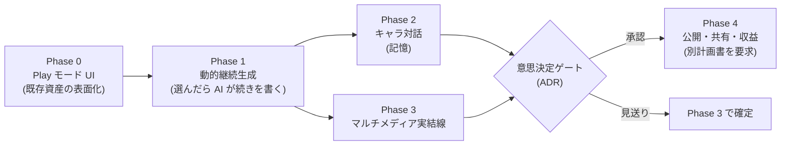

# 次期ロードマップ: プレイアブルノベル構想(ISEKAI ZERO 型体験の取り込み)

**作成日:** 2026-11-23
**ステータス:** 📋 提案(承認待ち)
**参照サービス:** [ISEKAI ZERO](https://www.isekaizero.ai/ja)(AIチャット × 物語ゲーム型ロールプレイプラットフォーム)
**前提ドキュメント:** `docs/STATUS.md`(実装状況 SSOT) / `docs/implementation_plans/if_routes_productization.md`(IF ルート製品化 72 ステップ計画)

---

## 0. サマリー

- **結論**: ISEKAI ZERO を「模倣」するのではなく「**接続**」する。AutoNovel の生成資産(小説)を**遊べる形に変換する**方向で取り込む
- **一言で**: 「条件を入れたら、小説が届き、**そのまま遊べる**」—— 生成→納品の後に「生成→再生」を足す
- **根拠**: 分岐・再生・課金・RAG・メディアミックスの中核はすでに実装済み(`docs/STATUS.md` §2 参照)。欠けているのは主にフロントの「遊ぶ見せ方」と「選択時の動的生成」
- **Phase 0〜3** は既存資産の延長で完結する。**Phase 4(UGC 公開・収益分配)** は機能追加ではなく運営事業の開始であるため、意思決定ゲートを設ける

---

## 1. 参照サービスの分解

ISEKAI ZERO の構成要素を、AutoNovel への参照価値で分解したもの。

| # | ISEKAI ZERO の要素 | 内容 | 参照価値 | 判定 |
|:--|:---|:---|:---|:---|
| F1 | 章立ての物語 + 選択肢 | 分岐と結末のある物語を「遊ぶ」。選択は世界に記憶される | 高 | ✅ 本線(Phase 0-1) |
| F2 | キャラクターの記憶 | 会話・選択を記憶し、態度や物語に反映される | 高 | ✅ 本線(Phase 2) |
| F3 | ビジュアルノベル演出 | 場面ごとのイラスト・動画・BGM で演出 | 中 | ✅ 本線(Phase 3) |
| F4 | マルチメディア展開 | ライトノベル/マンガ/動画/ボイスへの変換 | 高(既存 `media_mix` と構想が一致) | ✅ 本線(Phase 3) |
| F5 | ゲームメカニクス(d20 ダイス) | ランダム判定で運命が決まる | 低 | ⏸ 棚上げ(既存 `BranchType.RANDOM` で後日疑似実装可能) |
| F6 | 公開ストーリーライン + 探索 | 13K+ の公開ストーリーをコミュニティで共有 | 中(モデレーション等の運営コストが大) | 🔒 ゲート(Phase 4) |
| F7 | クリエイター収益分配(25%) | UGC による収益化 | 低(現段階では順序が前) | 🔒 ゲート(Phase 4) |
| F8 | Mana 型従量課金 | サブスクなし・メッセージ単位の従量課金 | 高(コスト構造の設計参考) | ✅ 設計参考(Phase 1 以降) |
| F9 | フルフリーチャット RP | 空のチャットから始まる自由ロールプレイ | 低(差別化が消える) | ❌ 非目標 |

### 採らない方向性(Non-goals)

1. **フルフリーチャット RP の本線化** — 「空のチャット」は既存大量競合(AI チャットサービス)と正面衝突する。AutoNovel の強みは監査・RAG・改稿を通った**執筆パイプライン品質の本文**であり、そこからの派生に絞る
2. **UGC プラットフォーム化の即時着手** — 公開・共有・収益分配はコードではなく**運営事業**(モデレーション・著作権・審査)。Phase 4 の意思決定ゲートを通すまで着手しない
3. **モバイルアプリ** — Web ファーストを維持。レスポンシブ対応の範囲に留める

---

## 2. ポジショニング

| | AutoNovel(現行) | ISEKAI ZERO | AutoNovel(次期構想) |
|:--|:---|:---|:---|
| 核となる体験 | 条件入力 → 小説生成 → 納品 ZIP | 世界に入り、選択で物語を進める | 生成 → 納品 → **そのまま再生** |
| 本文の品質管理 | 監査・RAG・改稿パイプライン | 生成次第(プレイ内で即時) | 同左(再生される本文もパイプライン通過) |
| 読者の参加 | なし(読み手) | 主体(プレイヤー) | 選択による分岐参加 |
| 収益構造 | 納品ベース | Mana 従量課金 | 納品 + 従量(動的生成はコストが発生するため) |

**差別化軸**: ISEKAI ZERO のストーリーは「遊ぶために設計された世界」。本構想は「**ちゃんとした小説が先にあり、それを遊べる形にする**」。生成品質の裏付け(監査・一貫性)を持つプレイアブルノベルは現状市場に存在しないポジション。

---

## 3. 現状資産マップ(2026-11-25 実装ベース)

`docs/STATUS.md` を SSOT として、ISEKAI ZERO 型体験に必要な要素の現状を整理する。

| 要素 | 現状 | 根拠 | ギャップと担当 Phase |
|:--|:---|:---|:---|
| 分岐グラフ生成・再生コア | ✅ 完成済み | `src/easy_mode/phase3/if_routes.py` — `CHOICE/CONDITIONAL/RANDOM/LOOP/MERGE`、`IFRouteGenerator`/`IFRoutePlayer`、`export_playthrough` | なし |
| Branch REST API(fork/merge/graph/play セッション) | ✅ 実装済み | `src/backend/routers/branches.py`(`/api/branches/*`、save/load/end/playthrough、nodes CRUD、editor/validate)。DB は `0015_add_branches_core` / `0016_add_branch_play_sessions` | なし |
| リアルタイム再生 | ✅ 実装済み | 同 router の `/play/{session_id}/ws`(認証付き WebSocket) | なし |
| **プレイ UI(フロント)** | ✅ 実装済み(Phase 0・2026-11-23) | `frontend/src/pages/PlayModePage.tsx`(`/app/play`、`/app/play/:bookId`)。ルート・ヘッダー導線・capability 宣言(`branchPlay: wired`)込み | なし(動的継続は次行) |
| **選択時の動的継続生成** | ❌ 未実装 | 現状は事前生成グラフ上の選択のみ。LLM が選択に応じて続きを書く経路なし | **Phase 1 の主対象** |
| キャラ対話(記憶) | ❌ 未実装 | 対話セッションモデルなし。RAG 基盤はあり(`RAGService`、pgvector > Chroma > InMemory フォールバック) | Phase 2 |
| 挿絵・演出 | 🟡 実装あり・未配線多数(2026-11-24 調査完了) | `src/publishing/illustration/`(SceneIllustrationService)、`src/agents/illustration_agent.py`、use_cases/DB リポジトリ。**詳細とギャップリストは `docs/plans/PHASE3_ILLUSTRATION_WIRING_SURVEY.md`** | Phase 3(最小価値経路は「表示配線」先行) |
| マルチメディア台本 | ✅ 実装済み | `src/easy_mode/phase3/media_mix.py`(MANGA/AUDIO_DRAMA/VIDEO/LIGHT_NOVEL/WEBTOON) | 実生成(画像/音声)への接続は Phase 3 |
| 課金基盤 | ✅ 実装済み(決済疎通未確認) | `src/backend/routers/billing.py`(Stripe: plans/balance/checkout/portal/transactions)+ webhook | 従量課金の設計拡張は Phase 1〜 |
| UGC 公開・共有 | ❌ 未実装 | なし | Phase 4(ゲート) |

### 命名に関する注意

Easy Mode Suite に「**Interactive Writer**」(章単位の執筆者向け対話生成、`docs/easy_mode_suite.md` §2.1)が既存する。本構想の**読者側**体験とは別物であるため、混同防止のために本構想の機能名は **「Play モード」** と呼ぶ。

---

## 4. フェーズ構成

### Phase 0: Play モード UI(既存資産の表面化)

- **目的**: 生成済み小説をフロントで「遊べる」状態にする。バックエンドは無変更で済む見込み
- **スコープ**:
  - `frontend/src/pages/` に Play モードページを新設(`/app/play/:bookId` 想定)。既存 3 入口(かんたん/ウィザード/Studio)からの導線を追加
  - グラフ型プレイ: シーン表示 → 選択肢 → 分岐 → playthrough 履歴表示。REST(`/api/branches/play/*`)を優先し、WS は任意
  - `frontend/src/capabilities.ts` への capability 宣言追加(既存の wired/planned 宣言パターンに従う)
  - プレイ計測イベント(開始/選択/完走)の追加
- **Non-goal**: 動的生成(Phase 1)、課金、公開
- **前提**: なし(バックエンド API は実装済み)
- **完了条件**:
  - [x] UI で「プレイ開始 → 選択 → セーブ/ロード → playthrough 表示」が完走(2026-11-23 完了。API レベル E2E 実施記録は `docs/implementation_plans/playable_novel_phase0.md` §7)
  - [x] 既存フロントテストを悪化させない(実測: 全 398 テストパス・失敗 0。なお実施環境 Node 26 では localStorage の環境問題があり `tests/setup.ts` を修復済み)
  - [x] Play モードのユーザーマニュアル追記(`docs/easy_mode_guide.md`「▶ Play モード」節)
- **概算規模**: フロント中心・小(既存 API への UI だけのため)

### Phase 1: 動的継続生成(選んだら AI が続きを書く)

- **目的**: 事前生成グラフの静的選択に加え、選択した時点で LLM が次シーンを生成し、新たな選択肢を提示する ISEKAI ZERO 型の体感を導入
- **スコープ**:
  - feature flag(例: `ENABLE_DYNAMIC_BRANCH`)**既定 OFF**。OFF 時は既存グラフ型プレイと挙動が同一であることを契約テストで担保(本リポジトリの既定パターン: 「フラグ OFF で既存挙動不変」)
  - 選択 → 次シーン生成の経路を WS(`play_ws`)に追加。同期応答のため Huey バッチは経由させない(対話は即時応答が前提)
  - 生成は既存執筆パイプラインの軽量版(コンテキスト構築 + 本文生成 + 簡易監査)を流用。4 層境界を守り、use_cases 層に新規ユースケースとして実装
  - コスト計測メトリクス(1 プレイあたりトークン/コスト)を `src/backend/observability/metrics.py` に追加
  - 従量課金の設計(Spending 実装は Stripe 基盤 `src/backend/routers/billing.py` を拡張。実装は Phase 2 以降にずらしてもよい)
- **Non-goal**: フルフリーチャット(自由入力での RP は選択肢の自由記述程度に限定して検討)
- **前提**: Phase 0 完了(2026-11-23)+ **KPI ベースライン取得**。KPI の前提連鎖: CI 有効化(GitHub Actions がリポジトリ設定レベルでブロック中・2026-11-24 確認、GitHub Settings 確認はユーザー側タスク)→ 本番デプロイ → `branch_play_sessions` の行集計
- **完了条件**:
  - [ ] flag ON で「選択 → 続き生成 → 新選択肢」が完走し、flag OFF で既存挙動がバイト単位で不変
  - [ ] 動的プレイの E2E テスト(REST + WS)が通過
  - [ ] cost/play の p95 が測定され、上限(アビュースガード)が効く
  - [ ] `make openapi` で `docs/openapi.json` 更新 + `npm run type:sync`
- **概算規模**: バックエンド中心・中(同期生成経路 + メトリクス + コスト設計)

### Phase 2: キャラ対話(記憶)

- **目的**: 生成済み小説の登場キャラクターと対話できる。ISEKAI ZERO の「記憶する AI キャラクター」に相当
- **スコープ**:
  - 対話セッションモデル(新テーブル + Alembic マイグレーション)。キャラプロファイル(`src/domain/character.py` 周辺)を起点に
  - 記憶は既存 RAG 基盤に委譲: 対話履歴・選択・関係性をベクトルストア(pgvector/Chroma)に書き込み、文脈として検索注入
  - SSE によるストリーミング応答(WS は Phase 1 のプレイで使用済み。対話では SSE を検討し、方式は実装計画で確定)
  - レート制限・上限(1 ユーザーあたりの対話コスト制御)
- **Non-goal**: キャラ同士の対話、音声合成(Phase 3 で台本のみ)
- **前提**: Phase 1(コスト管理・同期生成経路の再利用)
- **完了条件**:
  - [ ] 対話 → 記憶 → 次回対話への反映が確認できる
  - [ ] 既存小説本文との一貫性(RAG 注入)が検証されている
  - [ ] OpenAPI + フロント型同期
- **概算規模**: 中(新セッションモデル + RAG 接続)

### Phase 3: マルチメディア実結線

- **目的**: ISEKAI ZERO の「ビジュアルノベル演出」相当。プレイ画面に挿絵・BGM・表情差分を載せる
- **調査**: ✅ 完了(2026-11-24、`docs/plans/PHASE3_ILLUSTRATION_WIRING_SURVEY.md`)。STATUS.md への現況記載も済み
- **スコープ**(調査結果を反映した実装順):
  1. **保存される経路の修復**(P0): DI コンテナが `IllustrationAgent` に `repo` を注入しないため `/generate` が DB 非保存、`/batch` は `assert self.repo is not None` 失敗の推測、パイプラインは常に no-op → 実画像が積み上がる経路を作る
  2. **決定的クエリ API**(P0): `episode_number` + `illustration_type` での取得(prompt 部分一致+最新フォールバックの代替)
  3. **Play モード表示 + フォールバック**(P0): `PlayModePage` への画像取得/描画(`found:false` 時は非表示)
  4. **画像の HTTP 配信**(P1): `/static/illustrations/` のマウント or バイト配信 API(vite proxy にも無い)
  - `media_mix` 台本(MANGA/AUDIO_DRAMA/VIDEO/LIGHT_NOVEL)を Asset Pack / 納品物への実出力として統合
  - 音声(TTS)・動画生成は外部サービス依存が大きいため、本 Phase では**台本出力まで**を保証し、実生成はオプション扱い
- **Non-goal**: キャラボイスのリアルタイム再生、動画実生成
- **前提**: Phase 0(プレイ UI に演出を足す形)。**Phase 1 と並行着手可能**
- **着手前の意思決定**: 本線画像クライアントの決定(Imagen 直叩き `ImageService` vs 未配線 `GeminiImageClient` 等 3 系統の整理)→ **ADR 推奨**(サーベイ §5)
- **完了条件**:
  - [ ] プレイ中のシーンに挿絵が表示される(挿絵なしでもフォールバック動作)
  - [ ] マルチメディア台本が納品 ZIP に含まれる
- **概算規模**: 中〜大(外部生成サービスの選定次第)

### Phase 4(意思決定ゲート): 公開・共有・収益

- **位置づけ**: 機能開発ではなく**運営事業の開始判断**。このフェーズは本ロードマップでは設計しない
- **ゲート条件(すべて揃ったら ADR で別計画書を承認)**:
  - [ ] Phase 0-2 の KPI(§6)が基準値を満たす
  - [ ] モデレーション体制(審査フロー・通報対応・NSFW ポリシー。`docs/plans/NSFW_INVENTORY.md` と `ENABLE_NSFW=false` 既定の方針を整合させる)を確定できる
  - [ ] 収益モデル(Mana 型従量 / クリエイター分配率)の試算が存在する
  - [ ] 法務確認(UGC の著作権・利用規約 `docs/legal/TERMS_OF_SERVICE.md` の拡張)
- **見送りの場合**: Phase 3 で確定。AutoNovel は「作って、遊べる、納品ツール」として閉じる

---

## 5. 横断設計方針

| 項目 | 方針 |
|:--|:---|
| 4 層アーキテクチャ | 対話・プレイの新規モデルは domain → application(use_cases)→ infrastructure → interfaces の順で追加。既存 `src/backend/routers/branches.py` は interfaces 層の実装として維持(`scripts/check_layer_boundaries.py` ゲートを通す) |
| feature flag 契約 | 新挙動は必ず flag 既定 OFF で導入し、「OFF = 既存挙動不変」を契約テストで担保する(提案 5/8 で採用済みのパターン) |
| 同期 vs バッチ | プレイ/対話は同期応答(WS/SSE)。Huey バッチは事前グラフ生成・メディア生成など「待てる処理」に限定。混線させない |
| コスト構造 | 動的生成は 1 イベントごとにコストが発生する。メトリクス(cost/play、tokens/scene)を Phase 1 から取得し、Phase 2 以降の課金設計はその実測に基づく(ISEKAI ZERO の Mana 型を参照) |
| 安全設計 | NSFW は既定無効を維持(`ENABLE_NSFW=false`)。動的生成には既存監査系(`src/easy_mode/spice_guard.py` 等)の流用を検討し、出力フィルタを欠かさない |
| API 変更運用 | API 変更ごとに `make openapi` + `cd frontend && npm run type:sync`。CI の OpenAPI スナップショット整合を維持 |
| 品質ゲート現状 | フルスイート **9,570 パス / 失敗 0**(2026-11-25 実測。フレーキー根元原因 3 件を解消済み)。ただし **CI(GitHub Actions)はリポジトリ設定レベルでブロック中**で発火しない → 解消までゲートはローカル実行のみ |
| エージェント協業 | 複数エージェントの並行作業は **worktree + ブランチ分離**を必須とする。同一作業ツリーでの同時作業は、コミット取り違え・ブランチ切替競合を引き起こす(2026-11-24〜25 に実害が発生) |

---

## 6. KPI と検証

| KPI | 定義 | 対象 Phase | 目安(初期値は Phase 0 計測で決定) |
|:--|:---|:---|:---|
| プレイ開始率 | 生成完了者のうち Play を開始した割合 | Phase 0 | 基準値は初回計測後に設定 |
| 完走率 | プレイ開始 → 結末到達 | Phase 0-1 | 40% 超を目標仮置き |
| 動的選択率 | 動的継続が有効なプレイでの選択実行率 | Phase 1 | 基準値は初回計測後に設定 |
| cost/play | 1 プレイあたりの生成コスト | Phase 1 | 従量課金が成立する水準を Phase 2 で設計 |
| 対話継続率 | キャラ対話の 2 週間後再訪率 | Phase 2 | 基準値は初回計測後に設定 |
| レイテンシ | 動的継続の first-token p95 | Phase 1 | SLO.md との整合を確認 |

---

## 7. リスク Top5

| # | リスク | 兆候 | 対応 |
|:--|:---|:---|:---|
| 1 | **GitHub Actions が発火しない**(2026-11-24 確認: push しても check runs 0。YAML・workflow state は正常なためリポジトリ/アカウント設定レベルのブロック推定) | CI の check runs が増えない | GitHub Settings → Actions / Billing の確認(ユーザー側タスク)。解消まで品質ゲートはローカル実行のみで、KPI 蓄開始も遅延 |
| 2 | 動的生成のコスト暴走 | cost/play が設計値を超過、アビュース | Phase 1 で上限・レート制限を flag と同時に導入。メトリクス先行 |
| 3 | 対話のレイテンシで体験が破綻 | first-token p95 > 数秒 | ストリーミング必須。軽量パイプライン(監査簡略化)と通常パイプラインの二段構え |
| 4 | グラフ型(既存)と動的型の二重実装化 | 両モードの不具合が交互に発生 | 共通の play セッションモデルを維持し、動的継続は「グラフ拡張の一種」として実装。flag で切替 |
| 5 | Phase 4 の運営コスト過小評価 | 公開機能実装後に審査・通報対応が破綻 | Phase 4 はゲート制。モデレーション体制の確定を着手条件に |

> **解消済みリスク(記録)**: 旧リスク「フロントテスト基盤が失敗中(9 テスト)」は 2026-11-24 に解消(Node 26 localStorage 問題の修復 + フレーキー根元原因 3 件解消)。現状フルスイート 9,570 パス / 失敗 0(`docs/STATUS.md` §3-5)。

---

## 8. 意思決定ゲートと ADR

- **ADR-xxx 候補**: 「AutoNovel に Play モード(再生体験)を本線機能として導入するか」— Phase 1 着手前に `docs/adr/` に起票を推奨
- **ADR-yyy 候補**: 「UGC 公開・収益分配を行うか」— Phase 4 ゲートで起票
- 本ロードマップの実装計画書(ステップ分解)は、各 Phase 承認後に `docs/implementation_plans/` へ `playable_novel_phase<N>.md` として作成する

---

## 9. 関連ドキュメント

| ドキュメント | 関係 |
|:--|:---|
| `docs/STATUS.md` | 実装状況の SSOT。本書の「現状」列はこれに従い、進捗時に双方を更新する |
| `docs/implementation_plans/if_routes_productization.md` | IF ルート製品化の 72 ステップ計画。Phase 0/1 の実装計画の雛形 |
| `docs/easy_mode_suite.md` | Interactive Writer など既存機能の定義。命名の衝突に注意(§3) |
| `docs/plans/NSFW_INVENTORY.md` | NSFW 関連の棚卸し。Phase 4 のポリシー設計で参照 |
| `docs/ROADMAP_IMPROVEMENTS.md` | 品質向上系の別ロードマップ。本書とは並列(競合しない) |
| `docs/ROADMAP_PLAYABLE_NOVEL.md` の進捗 | 各 Phase 完了時に §3 の現状マップと §4 の完了条件を更新する |

---

## 改訂履歴

| 日付 | 版 | 内容 |
|:--|:--|:---|
| 2026-11-23 | 0.1 | 初版作成(提案段階・承認待ち) |
| 2026-11-25 | 0.2 | Phase 0 完了・ADR 002 承認・Phase 3 調査完了を反映。Phase 1 の前提に CI 有効化→デプロイ→KPI のブロッカー連鎖を明記。Phase 3 に調査結果の実装順(保存経路修復→決定的クエリ→表示→配信)を反映。§5 に品質ゲート現状・エージェント協業方針を追加。§7 を現実リスク(CI 不発)に更新 |
