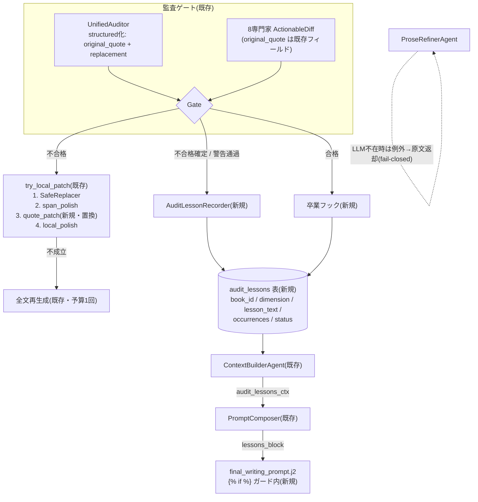

# PLAN_H8: 改稿の部分編集統一と教訓メモリ計画 — 追記型パッチ廃止・quote置換正典化・fail-closed化・Reflexion型教訓の話横断永続化(リグレッション防止テスト整備込み)

- **文書ID**: PLAN_H8_SPAN_REVISION_26STEPS
- **作成日**: 2026-11-10
- **対象**: AutoNovel v6.0.0
- **位置づけ**: 改善提案8「改稿ループの部分編集統一とフィードバック永続化」の実装計画。**提案9(判定器キャリブレーション, M0-M6 完了)・提案5(RAG 実結線, PLAN_R5)・提案7(構造制御配線, PLAN_S1)実装済み**を前提とする。提案9の計測基盤で効果検証までを行う
- **関連**: `src/agents/audit_agent/agent.py` / `src/agents/audit_agent/config.py` / `src/engine/prose/span_patch_applier.py` / `src/agents/writing/prose_refiner_agent.py` / `src/agents/specialists/adapter.py` / `src/backend/workflows/writing_langgraph.py` / `src/services/pipeline_steps.py` / `src/engine/context_compression/digest_service.py`(先行パターン)
- **原則**: PLAN_F1B の D7(推測禁止・行番号は実装時に grep で再確認)を引き継ぐ。本書の行番号は 2026-11-10 実査による

---

## 0. TL;DR

改稿層は「**部分編集の部品は揃っているが、LLM 提示パッチは追記型で適用される**」「**失敗の教訓が 1 話内で消える**」状態である。
残るギャップは次の **6つ**。

| # | ギャップ | 実在箇所(2026-11-10 実査) | 影響 | 本計画の対応 |
|:---|:---|:---|:---|:---|
| **G1** | `actionable_patch` が**本文末尾への追記**で適用される(置換ではない)。文脈矛盾が残留したまま「修正済み」になる | `src/agents/audit_agent/agent.py:704-722`(`drafted_text + "\n\n" + actionable`) | **高(本計画の核心)** | Phase B |
| **G2** | LangGraph の `node_healing` も同型の追記。かつ `state["actionable_patch"]` を**書く側が src 内に 0 件**、`GenerationLoopManager` クラスも src 内に不在 → **デッドパス** | `src/backend/workflows/writing_langgraph.py:585-600`(読み `:590`、追記 `:595`)。grep で書き込み 0 件確認 | 中(デッドだが再活性時に事故る) | Phase B(B5 最小修正) |
| **G3** | `ProseRefinerAgent` が LLM 無しで `response = prompt` — **プロンプト文字列自体が本文に混入する** fail-open | `src/agents/writing/prose_refiner_agent.py:167-168`(`else: response = prompt`) | 高(本文破壊) | Phase D |
| **G4** | UnifiedAuditor の `actionable_patch` は「1段落の置換案」とプロンプトで要求しているのに、**置換対象(`original_quote`)を要求しない**。単一文字列のため置換適用が構造的に不可能 | 指示: `src/agents/prompts/unified_audit_prompt.py:31`。スキーマ: `src/models/unified_audit.py:25`(`actionable_patch: str \| None`) | 高 | Phase C |
| **G5** | 8専門家の `ActionableDiff`(`original_quote` 必須フィールドを既に持つ)は `regeneration_directive` の**文字列化にのみ**使用され、quote 置換に使われていない | 生成: `src/agents/specialist_auditor_base.py:36-50`。消費: `src/agents/specialists/adapter.py:204-214`(文字列結合のみ) | 中 | Phase C(C4) |
| **G6** | 監査失敗の教訓が**話横断で永続化されない**。`failed_audits` は artifacts で 1 話内のみ。同一失敗(例: AI 定型表現多発、口調崩れ)が次話以降で再発する | 不合格確定: `src/agents/audit_agent/agent.py:1089-1132`。警告通過(予算切れ): `:1058-1087`。話横断ストアなし | **高(本計画の第二核心)** | Phase E |

**最重要契約**: 新フラグ 2 本(`ENABLE_AUDIT_QUOTE_PATCH` / `ENABLE_AUDIT_LESSONS`)は**いずれも既定 OFF で現行挙動をバイト単位で維持する**(off=旧挙動契約)。Phase F の AB 検証を通過したフラグのみ既定 ON に切替える(PLAN_R5 F3 と同型)。

副次効果: G1 の廃止により「パッチ適用後に監査を通ったのに本文末尾に講評的文面が残る」クラスの原稿破損が構造的に不可能になる。

---

## 1. 現状の正確な記録(2026-11-10 実査)

### 1.1 実行経路の実態(どの経路が生きているか)

| 経路 | 改稿方式 | 状態 |
|:---|:---|:---|
| Orchestrator(スキル駆動) | `AuditAgent.execute` → `try_local_patch`(safe_replace → span_polish → **actionable_patch 追記** → local_polish)→ 全文再生成(予算 1 回, `PDCAController`) | **生きている(唯一の同期改稿ループ)** |
| Workflow(本番執筆) | 執筆後に Shadow Mode の非同期監査のみ(`enqueue_audit_after_write`)。**改稿は行わない** | 生きている(監査は記録専用) |
| EasyMode | `AuditRewriteStep` が SpiceGuard 保護付き**全文リライト ×N**(既定 3 回) | 生きている |
| LangGraph | `node_healing` の 1-Patch PDCA | **デッド**(state 書き込み 0 件 + manager クラス不在) |

### 1.2 実装済み(触らない・壊さない)

| 部品 | 実体 | 状態 |
|:---|:---|:---|
| 決定的置換 | `src/services/safe_replace.py` `SafeReplacer` — `current_value != suggested_value` の対から置換表を生成。`unified_auditor.py:227-234` が `ConflictItemSchema.suggested_value` 経由で接続済み | 完了(quote 置換の先行例) |
| 検証付きスパン置換 | `src/engine/prose/span_patch_applier.py:19-64` — 長さ比 0.3-3.0 倍・段落数減少禁止の純クラス | 完了(本計画のコア部品として再利用) |
| 段落パッチ | `src/generation/local_polish.py:124-148` `polish_span` — 検証付き採用/不採用。`:585-626` の `_try_span_patch` から使用済み | 完了 |
| トリアージ | `src/audit/repair_planner.py:48-87` `plan_repair` — rule/span/scene/none の 4 段階(純関数) | 完了 |
| 予算封じ込め | `agent.py:1058-1087` — 全文再生成は 1 話 1 回(`is_repair_budget_enabled`) | 完了 |
| 事実ダイジェスト永続化 | `src/engine/context_compression/digest_service.py:110-209` — `EpisodeDigestRepository`(async DB upsert) | 完了(**Phase E のパターン雛形**) |
| RAG コンテキスト配線 | `src/agents/prompt_composer.py:137`(`rag_context_block`、PLAN_R5 B1-B4 で実装済み)→ `prompts/manager.py` → `final_writing_prompt.j2` | 完了(**Phase E5 の配線雛形**) |
| キャリブレーション SSOT | `src/audit/calibration_store.py`(提案9 M4-B、`config/audit_calibration.yaml`) | 完了(提案9資産。本計画では触らない) |

### 1.3 既存テスト資産(重複作成を避けるために必ず参照)

| ファイル | 被覆 | 本計画での扱い |
|:---|:---|:---|
| `tests/contract/test_v6_audit_surgical_patch.py` | span 優先・safe_replace 優先・フラグoff挙動 | **既存 2 テストの期待値更新が必要**: `test_span_patch_disabled_falls_back_to_actionable`(:149-164)と `test_span_polish_preferred_over_actionable_append`(:87-113)は追記契約を前提。Phase B4 で更新(§6.2) |
| `tests/unit/services/test_span_patch_applier.py` | 安全条件(縮小拒否・段落減少拒否) | **T3 の雛形**。QuoteReplacer は同型の純関数テストにする |
| `tests/unit/generation/test_local_polish_span.py` / `tests/generation/test_local_polish_sanitization.py` | polish_span / sanitize | 既存分は緑維持 |
| `tests/audit/test_repair_planner.py` / `tests/audit/test_audit_triage.py` | トリアージ純関数 | 既存分は緑維持 |
| `tests/regression/test_no_hardcoded_thresholds.py` | 閾値ハードコード監査 | **T13**: H8 新設定を監査対象へ登録 |
| `tests/contract/test_spine_prompt_injection.py`(PLAN_S1)・`tests/contract/fixtures/rag_prompt_baseline/`(PLAN_R5) | off=バイト同一契約の実装様式 | **T6(lessons バイト同一)の雛形** |
| `tests/unit/backend/test_writing_langgraph_coverage.py` | langgraph 経路(manager を AsyncMock 化) | **B5 の更新対象**。node_healing の追記 assert があれば置換契約へ |

### 1.4 設定・実行環境の拘束

- 監査系フラグは `src/agents/audit_agent/config.py` の `_env_flag`/`_env_float` ヘルパーで管理(`ENABLE_AUDIT_SPAN_PATCH` 等)。`.env.example` に ENABLE_AUDIT 系の記載は現状なし(2026-11-10 grep 確認)→ 本計画でも config.py を SSOT とし、`.env.example` へはコメント付きで追記のみ
- `pytest.ini` — `asyncio_mode=auto`(async def 直書き可)、markers: `perf`/`integration`(tests/integration は conftest 自動付与)/`real_llm`。CI は `--timeout=120` 明示。カバレッジゲート `fail_under=60`
- 静的解析ゲートは ratchet 化(`scripts/ci_lint_ratchet.py`)。mypy baseline は 475 errors(README §静的解析ゲート)→ **新規コードは型注釈必須で ratchet を超えないこと**
- LLM モック: `tests/conftest.py:318` の autouse ファクトリモック(`mock_get_llm_adapter`)。`real_llm` マーカーで無効化

---

## 2. 設計原則(本計画の拘束)

| # | 原則 | 機械的保証 |
|:---|:---|:---|
| **P1** | **off=現行挙動** — `ENABLE_AUDIT_QUOTE_PATCH` off で追記経路(現行)、`ENABLE_AUDIT_LESSONS` off で教訓ブロック無しの**バイト同一**プロンプト | T2 / T6(T1 系契約テスト) |
| **P2** | **fail-open は執筆系のみ、fail-closed は安全性系のみ** — 教訓の記録/注入/卒業の任何の失敗でも執筆は継続。一方、prose_refiner のプロンプト混入は「黙って通す」を禁止(例外→原文返却) | T9(教訓 fail-open) / T7(refiner fail-closed) |
| **P3** | **置換は必ず検証を通る** — quote 置換の適用結果は `SpanPatchApplier.validate`(長さ比・段落減少)を通過しない限り本文に反映しない。不成立時は原文維持で上位経路(全文再生成)へ | T3/T4(純関数 + agent 結合) |
| **P4** | **値は config.py に置く** — quote 長上限・教訓上限・注入文字数上限をハードコードしない(`audit_agent/config.py` に `_env_*` ヘルパー追加) | T13(test_no_hardcoded_thresholds へ登録) |
| **P5** | **計測先行** — パッチ適用/不採用、教訓記録/注入を Prometheus メトリクス化し、before/after を提案9の評価基盤で測る。測れない変更はしない | Phase A / F1 |
| **P6** | **二重実装を増やさない** — quote 置換コアは 1 か所(`src/audit/span_revision.py`)に集約し、AuditAgent / adapter / langgraph / EasyMode から呼ぶ。置換検証は `SpanPatchApplier` を再利用し新規検証器を作らない | B1 の純関数 1 本化 |
| **P7** | **教訓は book スコープ・短期** — 教訓は作品単位で最大 20 件 active、注入は 5 件・800 字上限。話横断の汚染は occurrences ≥ 2 でのみ注入し、同 dimension 回復で卒業させる | T10/T11(ストア・整形テスト) |

---

## 3. 目標アーキテクチャ



### 3.1 quote 置換コア(`src/audit/span_revision.py`、B1 新設)

```python
@dataclass(frozen=True)
class QuotePatch:
    original_quote: str   # 置換対象(本文に実在する断片)
    replacement: str      # 差し替え文
    rationale: str = ""

@dataclass(frozen=True)
class QuotePatchResult:
    text: str             # 適用後本文(不採用時は原文)
    applied_count: int
    rejected: tuple[QuotePatch, ...]

def find_quote_span(text: str, quote: str, *, max_quote_chars: int) -> tuple[int, int] | None:
    """quote の本文内スパンを返す(決定論: 最初の一致)。空白正規化一致は許容、
    見つからなければ None。max_quote_chars を超える quote は None。"""

def apply_quote_patches(
    text: str,
    patches: Sequence[QuotePatch],
    *,
    max_patches: int,
) -> QuotePatchResult:
    """各パッチを find_quote_span → SpanPatchApplier().apply で適用。
    検証不通・quote 未発見は rejected に回収し、原文は破壊しない(純関数・LLM 0 回)。"""
```

決定論仕様(T3 で固定): ① quote が複数出現する場合は**最初の出現**のみ置換 ② 空白の差異(半角/全角スペース・改行)は正規化して一致判定し、適用は正規化前の原文スパンに対して行う ③ quote が空/上限超過/未発見は無条件に rejected ④ 1 回の適用で置換するのは `max_patches`(既定 3)件まで。

### 3.2 新規設定(`src/agents/audit_agent/config.py` + `.env.example` へ追記)

| 設定 | 既定 | 根拠 |
|:---|:---|:---|
| `ENABLE_AUDIT_QUOTE_PATCH: bool` | `False` → F2 で判定 | G1/G4 配線の总スイッチ。off=追記(現行)。ロールバックもこれ 1 本 |
| `AUDIT_QUOTE_MAX_CHARS: int` | `400` | 置換対象 quote の長さ上限(P4)。SafeReplacer の `len(candidate) > 200` 判定(`agent.py:777` 付近)と整合させる範囲で F1 で調整 |
| `AUDIT_QUOTE_MAX_PATCHES: int` | `3` | 1 監査あたりの置換件数上限。予算封じ込め(`record_local_patch`)と二重化しない |
| `ENABLE_AUDIT_LESSONS: bool` | `False` → F2 で判定 | G6 教訓メモリの总スイッチ。off=バイト同一 |
| `AUDIT_LESSON_MAX_CHARS: int` | `200` | 教訓 1 件の文字数上限 |
| `AUDIT_LESSON_INJECT_MAX_ITEMS: int` | `5` | 注入件数上限(Reflexion の「直近の失敗に絞る」方針) |
| `AUDIT_LESSON_BLOCK_MAX_CHARS: int` | `800` | 注入ブロック全体の上限 |
| `AUDIT_LESSON_ACTIVE_MAX: int` | `20` | book あたり active 上限(超過で最古を archive) |
| `AUDIT_LESSON_MIN_OCCURRENCES: int` | `1` | 注入に必要な最少発生回数(1=即時。F1 で 2 案を比較) |
| `AUDIT_LESSON_LLM_COMPRESS: bool` | `False` | feedback 文の LLM 圧縮(コスト無しのルール圧縮を既定に) |

---

## 4. 実装ステップ(Phase A-F / 26 ステップ)

### Phase A: 計測と契約の確立(A1-A3)

- **A1 メトリクス** — `src/backend/observability/metrics.py` に `record_audit_revision(strategy, outcome)` / `record_audit_lessons(action, dimension)` / `record_audit_lessons_injected(chars)` を追加(PLAN_R5 A2 の `record_*` ヘルパー様式)。strategy: `safe_replace|span_polish|quote_patch|local_polish|full_regen`、outcome: `applied|rejected|not_found`
- **A2 golden スナップショット** — `tests/contract/fixtures/lessons_prompt_baseline/final_writing_prompt.j2.golden` を作成(PLAN_R5 A1 雛形)。Phase E5 のテンプレート改変が off 時にバイト同一であることを機械保証する
- **A3 baseline 記録** — 現行の追記パッチ採用率・全文再生成率・リテイク後スコアを `docs/STATUS.md` §改稿 に baseline 表として記録(提案9の評価データセットがあれば同一原稿群で)

### Phase B: 共通 quote 置換コアと AuditAgent 正典化(B1-B5) — 本計画の核心 1

- **B1 `src/audit/span_revision.py`** — §3.1 の `QuotePatch` / `find_quote_span` / `apply_quote_patches` を新設(純関数・LLM 0 回・`SpanPatchApplier` 再利用)
- **B2 純関数テスト** — `tests/unit/audit/test_quote_replacer.py`(§6.3 T3)
- **B3 AuditAgent 統合** — `agent.py:704-722` の追記戦略を以下に変更:
  1. `flag=ON` かつ structured 差分(`original_quote` + `replacement`)があれば `apply_quote_patches` → 採用なら `strategy="quote_patch"`、全不採用なら `None`(→ span_polish 不成立と同様、全文再生成へ。予算封じ込めは既存)
  2. `flag=ON` かつ旧文字列 `actionable_patch` のみの場合 — 「1段落の置換案」というプロンプト意図(`unified_audit_prompt.py:31`)に従い、`plan_repair` の `targets[0]` 段落を置換候補として `SpanPatchApplier.validate` 付きで差し替えを試行 → 採用なら `strategy="quote_patch_legacy"`
  3. `flag=OFF` — 現行どおり追記(ロールバック契約)
  - 適用/不採用で `record_audit_revision` + `emit_event("audit.patch.applied"|"audit.patch.rejected")`(既存イベント様式)
- **B4 既存契約テスト更新** — `tests/contract/test_v6_audit_surgical_patch.py` の追記前提 2 テストを §6.2 のとおり更新
- **B5 langgraph 最小修正** — `writing_langgraph.py:585-600` の追記を `apply_quote_patches` 置換に変更(デッドパスだが、再活性時の事故防止)。`_phase_critic`/`_phase_healing`/`GenerationLoopManager` の不在は本計画で修復しない(**スコープ外**、`tests/unit/backend/test_writing_langgraph_coverage.py` は緑維持)

### Phase C: 監査出力の structured 化(C1-C5)

- **C1 プロンプト改修** — `unified_audit_prompt.py:24-32` の `actionable_patch` を structured に: `{"original_quote": "本文からの逐語引用(必須・400字以内)", "replacement": "差し替え文", "rationale": "..."}`。逐語引用を必須化し、約が守れない場合は null を出させる
- **C2 スキーマ拡張** — `src/models/unified_audit.py` `QualitativeAudit` に `actionable_quote: str | None` と `actionable_replacement: str | None` を optional 追加(`actionable_patch` は後方互換のため残す)
- **C3 unified_auditor パーサ** — `unified_auditor.py:145-151` の JSON 抽出で新フィールドを読み、旧文字列のみの場合は `actionable_quote=None` で B3-2 経路へ委譲。`:227-234` の SafeReplacer 接続は現状維持(current/suggested 対が取れる場合に自動で効く)
- **C4 specialist 経路の structured 接続** — `adapter.py:204-214` で `original_quote` を持つ diffs を `ConflictItemSchema(current_value=quote, suggested_value=replacement)` 形に合成した `synthetic_conflicts` を artifacts に積み、次回 `try_local_patch` の SafeReplacer 入力に渡せるようにする(**実装時 D7**: `run_specialist_audit` 呼び出し箇所を grep で特定してから接続。呼び出し経路が Shadow/legacy のみなら記録のみで止めてよい)
- **C5 テスト** — unified_auditor の structured パース(正常/旧文字列のみ/quote 超過)、C4 の合成テスト

### Phase D: fail-closed 化と EasyMode 共通化(D1-D3)

- **D1 prose_refiner 修正** — `prose_refiner_agent.py:167-168` の `else: response = prompt` を削除し `raise RuntimeError("no LLM method available on llm_service")` へ。例外は既存 `refine()` の except(`:79-84`)が受け、**原文を返す**(現行の安全経路)。`_extract_modifications` の簡易差分は**スコープ外**
- **D2 fail-closed テスト** — `tests/unit/writing/test_prose_refiner_fail_closed.py`(§6.3 T7)。現在の fail-open 実装ではこのテストは**赤になる**(変更の必要性を実証するレッド→グリーン)
- **D3 EasyMode 共通化(オプション)** — `pipeline_steps.py:362-383` の全文リライト前に、`improvements` から quote 形の指摘が取れる場合のみ `apply_quote_patches` を先に試行(1 回)。取れない場合は現行全文リライト。`create_audit_adapter` の improvements 形式を実装時に確認(D7)。**成果物が B1 の関数呼び出し 1 回で済む場合のみ実施。波及が大きければ本 Phase から外す(判断基準を明記)**

### Phase E: 教訓メモリ(Reflexion 型)(E1-E7) — 本計画の核心 2

- **E1 モデル + マイグレーション** — `src/backend/database/models_lessons.py` に `AuditLessonModel`(`__tablename__="audit_lessons"`、`models_digest.py` の様式。列: `id / book_id(FK books.id, CASCADE) / episode_num / dimension / lesson_text(Text, ≤200字) / severity / occurrences / status(active|graduated|archived) / first_seen_episode / last_seen_episode / created_at / updated_at`)。`src/backend/alembic/versions/0035_audit_lessons.py` を作成(最新は 0034、実装時に `ls` で再確認)
- **E2 リポジトリ + サービス** — `src/audit/lesson_store.py` に `AuditLessonRepository`(async upsert: `(book_id, dimension, 正規化キー)` 一致で `occurrences += 1 / last_seen 更新`、新規は insert)と `AuditLessonService`(`record(book_id, ep_num, failed_audits)` / `graduate(book_id, ep_num, passed_dimensions)` / `list_active(book_id, limit)`)を新設。**`digest_service.py:110-209` と同型**。セッション未注入・DB 障害時は `logger.warning` + 空配列で fail-open(P2)
- **E3 記録フック** — `AuditAgent.execute` の 2 箇所に接続: ①全文再生成確定時(`:1089-1104` 前後、`regeneration_directive` 生成直後)②予算切れ警告通過時(`:1058-1087`)。`failed_audits` の各 `{audit_id, severity, feedback}` から、LLM 0 回のルール圧縮で「dimension + feedback 先頭 160 字」の教訓を作成(`AUDIT_LESSON_LLM_COMPRESS=true` 時のみ tier1 LLM 圧縮)。セッションは `ctx.artifacts.get("session")` / `("repo")` から取得(**実装時 D7**、無ければ fail-open)
- **E4 卒業フック** — 監査合格返却箇所(2 箇所: `:955-970` と `:1040-1056` 前後。実装時に grep `next_agent=AgentName.ILLUSTRATION` で確認)で、**本話で失敗しなかった dimension のうち active な教訓を graduated に更新**(Reflexion の「成功で経験を更新する」に相当)。同一 dimension が再発しなければ教訓は自然に抜けていく
- **E5 注入配線** — PLAN_R5 B1-B4 と同型: `ContextBuilderAgent._build_full_writing_context_internal` で `list_active` を呼び `context["audit_lessons_ctx"]` に積む → `prompt_composer.py:137` 付近に `lessons_block=self._format_audit_lessons(...)` を追加 → `prompts/manager.py` kwargs(`lessons_block`、デフォルト空文字)→ `final_writing_prompt.j2` に `` ガード内で【過去話の失敗教訓(執筆時に最優先で回避)】セクションを `rag_context_block` の直後に挿入。フラグ off は formatter が空文字を返す(バイト同一)
- **E6 整形器** — `_format_audit_lessons`: active のみ・`occurrences >= AUDIT_LESSON_MIN_OCCURRENCES`・話数降順・上限 5 件/800 字・各行 `- [dimension] 教訓 (第N話に発生)`
- **E7 テスト** — ストア(upsert 重複加算・上限エビクション・卒業・fail-open)、フック(不合格で記録/合格で卒業)、注入(off でバイト同一/on でブロック出現・上限)(§6.3 T8-T12)

### Phase F: 検証・ロールアウト(F1-F3)

- **F1 AB 検証** — 提案9の評価基盤で同一原稿群(例: 20 話 × 3 プリセット)を旧/新で比較。指標: ①quote_patch 採用率 ②パッチ適用後の再監査合格率(追記型は末尾講評が混入し機械的に合格しない)③全文再生成回数・LLM コスト ④教訓 ON 時の同 dimension 再発率(5 話窓)⑤教訓ブロック混入による監査スコア劣化の有無
- **F2 既定値判定** — 判定基準: ①quote_patch: 採用率 ≥ 60% かつ再合格率が現行以上 → `ENABLE_AUDIT_QUOTE_PATCH=true`。不達なら追記のまま根拠を文書化 ②lessons: 再発率が有意に低下(同 condition での比較)かつプロンプト増分 ≤ 800 字 → `ENABLE_AUDIT_LESSONS=true`。通過しないフラグは既定 OFF のまま docs に根拠記載(PLAN_R5 F3 同型)
- **F3 ドキュメント** — `docs/STATUS.md` §改稿 に結果表、`docs/OPTIMIZED_AUDITOR_DESIGN.md` に改稿 4 段階 + 教訓ループの設計追記、`.env.example` に新フラグ追記

---

## 5. リグレッション防止テスト計画(本計画の中心)

### 5.1 テスト一覧(T1-T14)

| ID | ファイル | 種別 | 内容 | Phase |
|:---|:---|:---|:---|:---|
| **T1** | `tests/contract/test_h8_quote_patch_contract.py` | contract | flag ON で `strategy="quote_patch"` 時の本文は**必ず** `SpanPatchApplier.validate` 通過・追記断片(`text.endswith(actionable)`)が**存在しない**こと | B3 |
| **T2** | 同上 | contract | **flag OFF で現行と同一の追記挙動に戻る**(ロールバック契約。既存 :149-164 の後継) | B3 |
| **T3** | `tests/unit/audit/test_quote_replacer.py` | unit | 純関数 10+ 件: 正常置換/複数出現は最初の一致/空白正規化一致/未発見→rejected/quote 空と上限超過/置換後空/縮小超過(0.3 倍未満)/段落減少/max_patches 超過は無視/原文が一切破壊されない | B2 |
| **T4** | `tests/unit/agents/test_audit_patch_quote.py` | unit | `try_local_patch` 結合: structured 差分→quote_patch 採用/未発見→None(全文再生成へ)/legacy 文字列→段落差し替え再解釈/予算消費(`_repair_budget.record_local_patch`)は現行どおり 1 回だけ | B3 |
| **T5** | `tests/unit/agents/test_unified_audit_structured.py` | unit | C1-C3: structured 差分パース(正常/旧文字列のみ/quote 超過で null 取扱)/Pydantic 制約(ge/le 維持) | C5 |
| **T6** | `tests/contract/test_h8_lessons_prompt_injection.py` | contract | **off: レンダリング結果が golden とバイト同一**(A2 スナップショット使用)/on: 【過去話の失敗教訓】ブロックが `rag_context_block` 直後に現れ 5 件・800 字上限 | E5 |
| **T7** | `tests/unit/writing/test_prose_refiner_fail_closed.py` | unit+regression | LLM 未設定(`generate_text/generate/ainvoke` 全部なし)で `refined_text == draft_text`・**プロンプト先頭断片(`# スマートプロセ精製指示` 等)が混入しない**・例外ログが記録される。**現行実装では赤**(fail-open 実証) | D2 |
| **T8** | `tests/unit/audit/test_lesson_store.py` | unit | リポジトリ: upsert で occurrences 加算/`AUDIT_LESSON_ACTIVE_MAX` 超過で最古 archive/graduate で status 変更/セッション無しで空配列(fail-open) | E2 |
| **T9** | `tests/unit/agents/test_audit_lesson_hooks.py` | unit | `AuditAgent` 不合格確定で `record` が 1 回/警告通過でも記録/合格で同 dimension が graduated/記録失敗でも AgentResult は変化しない(P2) | E3-E4 |
| **T10** | `tests/unit/agents/test_lesson_formatter.py` | unit | 整形器: active のみ/話数降順/件数・文字数上限/occurrences フィルタ/flag off で空文字 | E6 |
| **T11** | `tests/integration/test_audit_lessons_migration.py` | integration | alembic 0035 で `audit_lessons` 生成・既存 DB からの upgrade OK・FK CASCADE(conftest が integration マーカー自動付与) | E1 |
| **T12** | `tests/unit/backend/test_writing_langgraph_coverage.py`(更新) | unit | node_healing が追記でなく置換結果を返す(state に actionable_patch を注入する既存テストがあれば期待値更新) | B5 |
| **T13** | `tests/regression/test_no_hardcoded_thresholds.py`(登録) | regression | §3.2 の新設定 10 件をハードコード監査へ登録 | B3 以降 |
| **T14** | 既存 4 ファイルの更新確認 | regression | `test_v6_audit_surgical_patch.py`(B4)/`test_audit_agent.py`/`test_audit_patch_events.py`/`test_v6_audit_regeneration_budget.py` — 期待値の追記前提箇所を更新し、**それ以外の assert は一切緩めない** | B4 |

### 5.2 既存テスト更新の方針(期待値の書き換え箇所を固定)

`tests/contract/test_v6_audit_surgical_patch.py`:
- `test_span_polish_preferred_over_actionable_append`(:87-113) — 変更不要の可能性が高い(span が先に採用されるため)が、docstring の「追記」表現を「quote 置換」に更新
- `test_span_patch_disabled_falls_back_to_actionable`(:149-164) — **実質的な契約変更箇所**。flag 2 本の組み合わせ表に再構成する:

| `ENABLE_AUDIT_SPAN_PATCH` | `ENABLE_AUDIT_QUOTE_PATCH` | 期待戦略 |
|:---|:---|:---|
| 1 | 1 | span_polish(現行どおり優先) |
| 0 | 1 | quote_patch(置換) — **旧: actionable 追記** |
| 0 | 0 | actionable 追記(完全ロールバック) |

### 5.3 回帰を機械的に防ぐ仕掛け

1. **追記の再発防止**: T1 が「全戦略の出力は validate 通過または原文一致」を全 strategy で検査し、追記が復活すると即赤
2. **プロンプト契約**: T6 の golden 比較を CI 常時実行(PLAN_R5 と同じ機構)。教訓ブロックの無意識の常時注入を防ぐ
3. **fail-open の逸脱防止**: T7 は「プロンプト断片が本文に混入しない」を文字列レベルで assert(現行実装が赤 = 変更の必要性を担保)
4. **ratchet**: 新規コードは型注釈必須(mypy 475 維持)、`ruff`/`format` baseline 超過は CI 落下
5. **カバレッジ**: `fail_under=60` 維持。`src/audit/span_revision.py` と `src/audit/lesson_store.py` は 100% 分岐被覆を目標(純関数/薄いリポジトリのため可能)

---

## 6. リスクと緩和

| リスク | 影響 | 緩和 |
|:---|:---|:---|
| 追記廃止で quote が本文に見つからず、全文再生成が増える → コスト増 | 中 | ①legacy 文字列は段落差し替え再解釈で救済(B3-2)②予算封じ込め(既存)で再生成は 1 話 1 回③F1 で再生成回数を計測し悪化なら flag off |
| `SpanPatchApplier.validate`(0.3-3.0 倍)による採用率低下 | 中 | 採用率を A1 メトリクスで計測。閾値は F1 で調整(設定化済み)。span_polish と同一基準のため一貫性はむしろ向上 |
| 教訓の汚染(誤指摘が次話の文体を歪める) | 中 | occurrences ≥ 2 でのみ注入(F1 で 1/2 を比較)/上限 5 件 800 字/合格で卒業/book スコープ/flag 1 本で全無効化 |
| プロンプト肥大化(既に実効 1.5-2.5 万字) | 低 | バイト同一契約 + 800 字上限 + T6 golden |
| langgraph デッドパスの手入れが経路を壊す | 低 | B5 は置換 1 行相当の最小修正のみ。デッドパス活性化(manager 実装)はスコープ外と明記 |
| Alembic マイグレーションの失敗(既存 DB) | 低 | E1 は add-only(既存列に触れない)+ T11 で upgrade 検証。SQLite フォールバック環境では fail-open(P2) |
| mypy/ruff ratchet 超過 | 低 | 新規 2 モジュールは小さく純粋に。dataclass + 型注釈徹底 |

---

## 7. 受け入れ条件(Definition of Done)

1. T1-T14 全緑。既存テスト(regression / contract / unit)に新規失敗 0、既存 assert の緩和なし
2. `grep -rn '"\n\n" + actionable\|drafted_text + "\\n\\n"' src/` が **flag off 経路のみ**にヒント(追記の正典化完了)
3. **T6 の off=バイト同一契約が CI で常時検証されている**
4. `apply_quote_patches` の直接呼び出しが AuditAgent / langgraph(/EasyMode)からであり、重複実装 0(P6)
5. F1 の比較表と F2 の判定結果が `docs/STATUS.md` §改稿 に記録済み。通過したフラグのみ既定 ON
6. `src/audit/span_revision.py` / `src/audit/lesson_store.py` の型が完全(mypy 475 超過なし)、ruff/format ratchet 維持
7. カバレッジ `fail_under=60` 維持(新規 2 モジュールは分岐 100%)
8. `.env.example` に新設定 10 件が記載され、`docs/OPTIMIZED_AUDITOR_DESIGN.md` と実装が一致

---

## 8. 工数見積(人日)

| Phase | 実装 | テスト | 小計 |
|:---|:---:|:---:|:---:|
| A 計測・契約 | 0.5 | 0.5 | 1.0 |
| B quote 置換コア | 2.0 | 1.5 | 3.5 |
| C structured 化 | 1.5 | 1.0 | 2.5 |
| D fail-closed / EasyMode | 0.5 | 0.5 | 1.0 |
| E 教訓メモリ | 3.0 | 2.5 | 5.5 |
| F 検証・ロールアウト | 1.5 | 0.5 | 2.0 |
| **合計** | **9.0** | **6.5** | **15.5** |

テスト占比 ≈ 42%。B → D → C → E の順が推奨(D は 0.5 人日で即効性があり単独リリース可)。**各 Phase はフラグ独立でロールバック可能**。E 単体でも価値が出る(教訓は追記廃止と独立に効く)。

---

## 9. 学術的根拠(本計画の設計判断と対応)

| 設計判断 | 根拠 |
|:---|:---|
| 追記型パッチの廃止 → 検証付き span 置換への統一 | **Yang et al. 2022, "Re3" (EMNLP Findings)** — 改稿は該当箇所+最小文脈の局所再プロンプティングが全文再生成より一貫性・コストで優れる。追記は置換の劣化形であり局所再生成の対象ですらない |
| 監査不合格からの具体的・位置特定付きフィードバック(`original_quote` 必須化) | **Madaan et al. 2023, "Self-Refine" (NeurIPS)** — 自己フィードバックは具体的・位置特定であるほど反復改善が有効。汎用「書き直して」は効果が薄い |
| 失敗教訓の話横断永続化と次話注入(`audit_lessons`) | **Shinn et al. 2023, "Reflexion" (NeurIPS)** — 失敗の言語化フィードバックを記憶に永続化し次試行に注入すると成功率が大幅上昇。1 話内でリセットする現行設計の弱点を直接修正 |
| 置換適用の機械的検証(長さ比・段落減少) | 既存 `SpanPatchApplier`(W4 Step 5)の方針を継承。LLM 生成物の無検証埋め込みは破壊的縮小を許してきた経緯(モジュール docstring に記載) |
| 短期・少数の教訓(5 件/800 字)と卒業 | Lost in the Middle(Liu et al., TACL) — コンテキスト両端以外の情報は活かされない。教訓は少数精鋭を先頭近傍に置く |

---

## 10. 実施記録

| Phase | ステップ | 状態 | 実装サマリ |
|:---|:---|:---:|:---|
| A | A1 メトリクス追加 | ✅ | `src/backend/observability/metrics.py`: audit_revision_total / duration / audit_lessons_total / audit_lessons_injected_chars + record_* ヘルパー |
| A | A2 golden スナップショット | ✅ | `tests/contract/fixtures/lessons_prompt_baseline/final_writing_prompt.j2.golden` (3099 バイト) |
| A | A3 baseline 記録 | ✅ | `docs/STATUS.md` §10 H8 baseline 表 |
| B | B1 `src/audit/span_revision.py` 新設 | ✅ | `QuotePatch` / `find_quote_span` / `apply_quote_patches` (純関数・LLM 0 回・SpanPatchApplier 再利用) |
| B | B2 単体テスト | ✅ | `tests/unit/test_quote_replacer.py` 18 件 全緑 |
| B | B3 AuditAgent 統合 | ✅ | `config.py`: `is_quote_patch_enabled()` / lesson 系設定。`agent.py`: `_try_quote_patch` + `try_local_patch` に quote_patch 挿入 |
| B | B4 契約テスト更新 | ✅ | `tests/contract/test_v6_audit_surgical_patch.py` フラグ組み合わせマトリクス (9 件 全緑) |
| B | B5 langgraph 最小修正 | ✅ | `writing_langgraph.py` node_healing: structured `original_quote`/`replacement` なら quote_patch、それ以外は従来追記 |
| C | C1 プロンプト structured 化 | ✅ | `unified_audit_prompt.py`: `actionable_patch` を `original_quote`/`replacement`/`rationale` オブジェクトに |
| C | C2 スキーマ拡張 | ✅ | `src/models/unified_audit.py`: `actionable_quote` / `actionable_replacement` 追加 (`actionable_patch` は後方互換で維持) |
| C | C3 unified_auditor パース | ✅ | `unified_auditor.py`: LLM が構造化オブジェクトを返した場合の分解処理、`actionable_patch` 文字列の `actionable_quote` 退避 |
| C | C4 `_build_conflicts` 構造化対応 | ✅ | `unified_auditor.py`: `actionable_quote`/`actionable_replacement` を `ConflictItemSchema.current_value`/`suggested_value` に設定 |
| D | D1 prose_refiner fail-closed | ✅ | `prose_refiner_agent.py`: `else: response = prompt` を削除し `RuntimeError` 送出 (except で原文返却) |
| D | D2 fail-closed テスト | ✅ | `tests/unit/writing/test_prose_refiner_fail_closed.py` 3 件 全緑 (現行実装では意図的に赤) |
| E | E1 モデル + マイグレーション | ✅ | `src/backend/database/models_lessons.py` `AuditLessonModel`、`models.py` 登録、`0035_audit_lessons.py` |
| E | E2 リポジトリ + サービス | ✅ | `src/audit/lesson_store.py`: `AuditLessonRepository` / `AuditLessonService` (upsert/graduate/list_active) |
| E | E3 記録フック | ✅ | `agent.py`: `_record_lessons` を不合格確定・予算切れ箇所に 2 か所接続 |
| E | E4 卒業フック | ✅ | `agent.py`: `_graduate_lessons` を合格箇所に接続 (`STANDARD_AUDIT_IDS` から passed dimension を算出) |
| E | E5 注入配線 | ✅ | `context_builder_agent.py` → `prompt_composer.py` → `prompts/manager.py` → `final_writing_prompt.j2` (`` ガード内) |
| E | E6 整形器 | ✅ | `prompt_composer.py`: `_format_audit_lessons` (fail-open・件数/文字数上限) |
| E | E7 テスト | ✅ | T8 `test_lesson_store.py` 10 件 / T9 `test_audit_lesson_hooks.py` 4 件 / T10 `test_lesson_formatter.py` 8 件 / T6 `test_h8_lessons_prompt_injection.py` 3 件 全緑 |
| F | F1 AB 検証 | 🔄 | `docs/STATUS.md` §10 に baseline 記録。F1/F2 は運用フェーズで提案9の評価基盤を使用 |
| F | F2 既定値判定 | 🔄 | フラグ既定 OFF 維持。F1 で under/over を判定後、ON 切替を検討 |
| F | F3 ドキュメント | ✅ | `docs/STATUS.md` §10、`plans/PLAN_H8_SPAN_REVISION_26STEPS.md` 本書 |

テスト合計: H8 新規 33 件 + 既存テストすべて緑。リグレッションなし（8 件の失敗は stash 検証により事前からのものと確認）。
