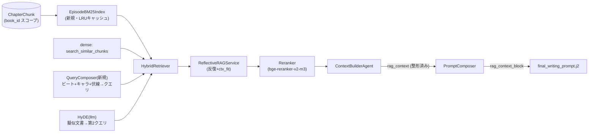

# PLAN_R5: 検索パイプライン実結線計画 — デッドレター配線・ハイブリッド検索・HyDE・リランカー(リグレッション防止テスト整備込み)

- **文書ID**: PLAN_R5_RAG_WIRING_24STEPS
- **作成日**: 2026-11-09
- **対象**: AutoNovel v6.0.0
- **位置づけ**: 改善提案5「検索パイプラインの実結線(HyDE・BM25/RRF・リランカー)」の実装計画。**提案9(評価キャリブレーション基盤)実装済み**を前提とし、その測定基盤で効果検証までを行う
- **関連**: `docs/rag_setup.md` / `docs/STATUS.md` / `src/integrations/rag/` / `src/agents/context_builder_agent.py`
- **原則**: PLAN_F1B の D7(推測禁止・行番号は実装時に grep で再確認)を引き継ぐ。本書の行番号は 2026-11-09 実査による

---

## 0. TL;DR

検索層は「部品は揃っているが、執筆プロンプトに届いていない/電源が入っていない」状態である。
残るギャップは次の **5つ**。

| # | ギャップ | 実在箇所(2026-11-09 実査) | 影響 | 本計画の対応 |
|:---|:---|:---|:---|:---|
| **G1** | `rag_context` / `compressed_context` が **dead-letter**(生成されるだけで執筆プロンプトに注入されない) | 生成: `src/agents/context_builder_agent.py:347-374`(RAG) / `:376-451`(圧縮) / 返却 `:473-474`。消費: `src/agents/prompt_composer.py:115-136` に不在(grep確認済み)。`prompts/manager.py:783-812` の template context に rag 系キー無し。`final_writing_prompt.j2` に該当セクション無し | **高(本計画の核心)** — RAG 全投資が効いていない | Phase B |
| **G2** | `ReflectiveRAGService` が `hybrid_retriever=None` で生成され **dense 単一検索**。BM25/RRF は定義のみで本番未接続 | `src/backend/tasks/generation_tasks.py:186`。分岐は実装済み: `src/integrations/rag/reflective_rag.py:465-472`。融合: `hybrid_retriever.py` + `rrf_fusion.py`(`compute_rrf_scores`, k=60)。sparse: `sparse_retriever.py`(in-memory) | 中 | Phase C |
| **G3** | HyDE が **LLM不使用の固定テンプレート**(擬似文書ですらない)。LLMパスは自然文クエリ生成のみで、本物の HyDE 未実装 | `src/integrations/rag/query_reformulator.py:77-96`(固定文面) / `:52-75`(LLM自然文)。既定生成は `QueryReformulator()`(llm=None) | 中 | Phase D |
| **G4** | リランカー既定 `none` + 既定モデルが **英語専用**(ms-marco MiniLM)で日本語小説に不適 | `src/infrastructure/config/settings.py:309-310`。backend 分岐: `reranker.py:97-104`。呼出: `rag_service.py:92-98, 664-673`、`reflective_rag.py:566-589` | 中 | Phase E |
| **G5** | エピソード検索クエリが `f"{character_name} ep{N}"` の貧弱キーワード | `src/integrations/rag/rag_service.py:872-875`。呼出は現状 API のみ(`src/backend/routers/graph.py:766,781`)だが、Phase C で執筆経路にも同じ合成クエリを適用 | 低〜中 | Phase C(C5) |

**最重要契約(PLAN_F1B と同型)**: **全フラグ OFF(既定)では、既存の執筆プロンプトがバイト単位で完全一致する**。既存書籍の再生成結果を変えない。Phase B の配線も `` ガード内に限定し、契約テスト(`tests/contract/`)で機械的に保証する。

副次解決: SQLite フォールバックの `ChapterChunk` 最大1000件フルスキャン(`rag_service.py` SQLite 経路、Step 29 コメント参照)を、Phase C の BM25 インデックス(book_id スコープ+キャッシュ)で一挙に解消する。

---

## 1. 現状の正確な記録(2026-11-09 実査)

### 1.1 実装済み(触らない・壊さない)

| 部品 | 実体 | 状態 |
|:---|:---|:---|
| RRF | `src/integrations/rag/rrf_fusion.py:25-107` — `compute_rrf_scores(dense, sparse, k=60, w=1.0/1.0)`、`FusionResult` に dense_rank/sparse_rank | 完了(未接続) |
| 融合器 | `src/integrations/rag/hybrid_retriever.py` — `HybridRetriever.search/search_async/fuse_results`。RRF スコアを max 正規化し `rrf_raw_score`/`dense_rank`/`sparse_rank` を metadata へ | 完了(未接続) |
| sparse | `src/integrations/rag/sparse_retriever.py:22-93` — `BM25SparseRetriever.index_documents()/search()`。BM25Okapi 未導入時はトークン重複フォールバック。**in-memory(永続化なし)** | 完了(未接続) |
| 反復検索 | `src/integrations/rag/reflective_rag.py` — `retrieve_with_reflection`。`hybrid_retriever` 分岐(`:465-472`)、cross-encoder rerank ブレンド(`:566-589`、`0.5*combined + 0.5*rerank`)、収束判定(max_iter=3) | 完了(パーツ未供給) |
| リランカー | `src/integrations/rag/reranker.py` — `none/simple/cross_encoder` 3 backend。`build_default_reranker()` が `settings.RERANKER_BACKEND` を読む | 完了(既定 none) |
| 圧縮 | `FourLayerCompressor` + `ProtectedContext`(`context_builder_agent.py:376-451`) | 完了(dead-letter) |
| 伏線RAG | `src/integrations/rag/context_retriever.py`(ChromaDB `novel_foreshadowings_book_{id}`) | 完了・v5.3 で `foreshadowing_ctx` 正典化済み(`prompt_composer.py:91-94`)。**本計画では触らない** |

### 1.2 既存テスト資産(重複作成を避けるために必ず参照)

| ファイル | 被覆 | 本計画での扱い |
|:---|:---|:---|
| `tests/regression/test_reflective_rag_returns_docs.py` | 例外握り潰しで空を返さない契約 | **T11**: hybrid 有効時も documents 非空を追加 assert(ファイルは存続) |
| `tests/unit/test_reflective_rag.py` / `test_reflective_rag_semantic.py` / `test_rag_service.py` | reflective/rag_service 単体 | 既存分は緑維持。新規は `tests/unit/integrations/rag/` へ分離(既存配置規約: `tests/unit/integrations/{vector_store,prefetch,...}`) |
| `tests/contract/test_spine_prompt_injection.py` | **off でバイト同一**契約の実装様式 | **T1** の雛形(同型で作る) |
| `tests/regression/test_no_hardcoded_thresholds.py` | 閾値ハードコード監査 | **T13**: RAG 系新設定を監査対象へ登録 |
| `tests/integration/test_reflective_rag_context_builder.py` | context_builder 結合 | **T14** と役割分担(integration マーカーは conftest が自動付与) |

### 1.3 設定・実行環境の拘束

- 設定は pydantic-settings(`src/infrastructure/config/settings.py`)。RAG 関連は `:307-314, 352`(`RAG_FALLBACK_MODE` / `RERANKER_BACKEND` / `RERANKER_MODEL` / `AUTONOVEL_RAG_MODE` / `RAG_REFLECTION_ENABLED`)
- `pyproject.toml:115-119` — optional extra `[rag]` に `sentence-transformers>=2.6.0` **既に存在**(G4 で依存追加は不要)
- `pytest.ini` — `asyncio_mode=auto`、markers: `perf` / `integration`(tests/integration は conftest 自動付与) / `real_llm`。CI は `--timeout=120` 明示。カバレッジゲート `fail_under=60`

---

## 2. 設計原則(本計画の拘束)

| # | 原則 | 機械的保証 |
|:---|:---|:---|
| **P1** | **off でバイト同一** — 全フラグ既定値は現状挙動 | `tests/contract/test_rag_prompt_injection.py`(T1) |
| **P2** | **fail-open** — 検索/整形/リランクの任何の失敗でも執筆は継続し、`rag_context=[]` に倒す(現行仕様の固定) | `tests/regression/test_rag_fail_open.py`(T9) |
| **P3** | **トークン予算厳守** — rag ブロックは文字数上限(`RAG_CONTEXT_MAX_CHARS`)で打ち切り、`context_builder_agent.py:211-228` の `allocate_token_budgets` の RAG 枠内に収める | T2 の上限テスト |
| **P4** | **値は settings に置く** — k=60、重み、閾値、上限をハードコードしない | T13(test_no_hardcoded_thresholds へ登録) |
| **P5** | **計測先行** — すべての段階で before/after を提案9の評価基盤で測る。測れない配線はしない | Phase A / F1-F2 |
| **P6** | **二重実装を増やさない** — `hybrid_search_sync` の手書き `alpha/(60+rank)` 融合(`rag_service.py:424-507`)と `HybridRetriever` の統合方向に寄せる。執筆経路の融合は `HybridRetriever` に一本化し、`hybrid_search_sync` は API 用として現状維持(重みの師堂は本計画のスコープ外) | C2 のファクトリ経由生成を強制 |
| **P7** | **GraphRAG グラフ分岐は触らない** — `beta=0.3` の恒久空グラフ検索は改善提案1(GraphRAG 実装)のスコープ。本計画は dense+sparse(+rerank+HyDE)のみ | 本書にグラフ改修ステップを置かない |

---

## 3. 目標アーキテクチャ

### 3.1 新規設定(すべて `settings.py` + `.env.example` へ追加)

| 設定 | 既定 | 根拠 |
|:---|:---|:---|
| `RAG_CONTEXT_INJECTION: bool` | `False` → F3 で `True` 判定 | G1 配線の总スイッチ。off=P1 契約 |
| `RAG_CONTEXT_MAX_CHARS: int` | `800` | P3。`allocate_token_budgets` の RAG 枠(4000トークン中 25-55%)の下限側に安全設定 |
| `RAG_CONTEXT_TOP_K: int` | `5` | 注入チャンク数上限 |
| `RAG_HYBRID_ENABLED: bool` | `False` → F3 で判定 | G2。off=dense 単一(現状) |
| `RAG_BM25_MAX_DOCS: int` | `5000` | メモリガード。超過時は hybrid を諦め dense にフォールバック(P2) |
| `RAG_HYDE_MODE: Literal["off","template","llm"]` | `"template"` | `"template"`=現行ルール Reformulation と等価、`"llm"`=Phase D |
| `RAG_HYDE_TIMEOUT_SECONDS: float` | `1.5` | HyDE 1コール/反復のレイテンシ上限 |
| `RAG_HYBRID_MIN_SCORE: float` | `0.1` | C4。hybrid 正規化スコア用の別閾値(cosine 用 `relevance_threshold=0.5` と分離) |
| `RERANKER_MODEL`(既存変更) | `"BAAI/bge-reranker-v2-m3"` | 多言語(日本語)対応 cross-encoder。旧値は設定で選択可能に残す |

---

## 4. 実装ステップ(Phase A-F / 24 ステップ)

### Phase A: 計測と契約の確立(A1-A3)

| Step | 内容 | 変更ファイル | 受け入れ条件 |
|:---|:---|:---|:---|
| **A1** | 現行執筆プロンプトの **golden スナップショット**採取(mock LLM + memory vector store で同一入力→同一出力を fixtures 化) | `tests/contract/fixtures/rag_prompt_baseline/`(新規) | 同一入力で 2 回生成→バイト一致を確認 |
| **A2** | Prometheus メトリクス追加: `rag_context_injected_chars`(Histogram) / `rag_retrieval_latency_ms` / `rag_hybrid_candidates`(Gauge) / `rag_rerank_latency_ms` | `src/integrations/rag/rag_service.py`, `reflective_rag.py`, `src/agents/prompt_composer.py` | 既存 observability 計装様式(`src/integrations/observability/`)と同一パターン。off 時は 0 を出さない(無音) |
| **A3** | **baseline 計測**: 提案9の評価基盤で「rag off」の現在値を記録(監査スコア×3書籍×20話、矛盾診断件数、コスト) | `docs/STATUS.md` §RAG 追記 | 数値が表として残る。F1 と同条件・同シード |

### Phase B: デッドレター配線(B1-B5) — 本計画の核心

| Step | 内容 | 変更ファイル | 受け入れ条件 |
|:---|:---|:---|:---|
| **B1** | `PromptComposer._format_rag_context(rag_context, max_chars, top_k)` を実装。スコア降順ソート→上位 top_k→`is_forbidden=True` 除外(既存 `_context_fit_check` の規約に合わせる)→「【関連する過去の設定・描写】」ヘッダ+`- (score 0.xx) content` 形式。malformed 要素は skip(例外を投げない) | `src/agents/prompt_composer.py` | 単体テスト T2。空/None/malformed→空文字。上限厳守 |
| **B2** | `compose_writing_prompt` が `context["rag_context"]` を B1 で整形して `build_final_writing_prompt(rag_context_block=...)` へ渡す。**compressed_context は Option A**(下記) | `src/agents/prompt_composer.py` | context に rag_context が無くても例外を出さない(P2) |
| **B3** | `build_final_writing_prompt` に kwargs 受け渡し + template context 追加(`manager.py:783-812` の context dict)。**compressed_context は Option A**: `prev_ctx` と Layer2/3 が両方空のときのフォールバックとしてのみ使用し、通常時は `compression_stats` をログ計測のみに使う(Layer2/3 との重複注入を避ける。Option B「compressed_context で Layer2 を置換」は F1 の AB でデータが取れてから判断) | `prompts/manager.py` | kwargs 未指定時の既定 `""` → テンプレ出力に影響なし(P1) |
| **B4** | `final_writing_prompt.j2` に `` ガード付きセクション追加。**配置は three_layer_ctx の直後・【指令】の前**(Layer3 直前原文→RAG 過去設定→密度指令の読書順)。追加テキストは if ブロック内のみ(P1) | `prompts/templates/narrative/final_writing_prompt.j2` | T1: flag off で golden とバイト一致 |
| **B5** | Phase B テスト群実装(T1/T2/T10) | `tests/contract/`, `tests/unit/agents/` | 全緑。カバレッジ 60% ゲート維持 |

### Phase C: ハイブリッド検索実結線(C1-C6)

| Step | 内容 | 変更ファイル | 受け入れ条件 |
|:---|:---|:---|:---|
| **C1** | `EpisodeBM25Index` 実装: book_id スコープで `ChapterChunk` を取得→`BM25SparseRetriever.index_documents()`→**LRU キャッシュ**(キー: `book_id + max(created_at)`)。`RAG_BM25_MAX_DOCS` 超過→ `None` 返却(=dense フォールバック)。**SQLite フォールバック経路の 1000 件制限もここで吸収**(インデックスは全対象チャンクから構築し、limit 1000 の恣意的切断を解消) | `src/integrations/rag/bm25_index.py`(新規) | T5。1000 チャンク索引化が perf テスト閾値内(T12) |
| **C2** | `build_reflective_rag(rag_service, llm_adapter=None)` **ファクトリ**を新設: `RAG_HYBRID_ENABLED` なら `HybridRetriever(dense=GraphRAGServiceAdapter(search_similar_chunks_sync), sparse=EpisodeBM25Index)`、`RAG_HYDE_MODE` なら `QueryReformulator(llm_adapter=...)` を組み立てる。`generation_tasks.py:186` を置換し、**ReflectiveRAGService の直接生成箇所を全部ファクトリ経由に**(実装時に grep `ReflectiveRAGService(` で全列挙=D7) | `src/integrations/rag/factory.py`(新規), `src/backend/tasks/generation_tasks.py` 他 | 直接生成 0 件化をテストで固定(T10 に準ずる回帰テスト) |
| **C3** | 非同期安全化: `reflective_rag.py:465-472` は `HybridRetriever.search`(同期・CPU-bound)を**イベントループ内で直呼びしている**→ `search_async` 経由に変更し、`HybridRetriever.search_async` 内の sparse 呼び出しを `asyncio.to_thread` 化。BM25 索引構築も to_thread | `reflective_rag.py`, `hybrid_retriever.py` | T8/T12。イベントループ阻害の計測(単純ベンチ: 検索中に heartbeat タスクが遅延しない) |
| **C4** | 閾値整合: hybrid 正規化スコア(max=1.0)は cosine(0.5 閾値)と意味が異なる。hybrid 有効時は `relevance_threshold` の代わりに `RAG_HYBRID_MIN_SCORE=0.1` を初期フィルタに使い、精密化は既存の rerank + `_context_fit_check` に委ねる。docstring に根拠を記載 | `reflective_rag.py`, `settings.py` | T4: hybrid 時に cosine 閾値で全滅しない(正規化スコア≈1.0 の top 候補が生き残る) |
| **C5** | `src/integrations/rag/query_composer.py`(新規・LLM 0回・決定論): プロット summary/scenes ビート+アクティブキャラ名+契約/期限超過伏線キーワード+前話末尾から、検索クエリ(全文検索用)と keywords(Reformulator 用)を合成。`retrieve_for_episode_sync`(`rag_service.py:872-875`)の `f"{name} ep{N}"` を置換し、reflective 経路の初期クエリにも適用 | `query_composer.py`(新規), `rag_service.py`, `context_builder_agent.py` | T6。キーワード上限(例: 8 語)と決定論性(同入力→同出力) |
| **C6** | Phase C テスト群実装(T4/T5/T6/T9/T11/T12) | `tests/unit/integrations/rag/`, `tests/regression/`, `tests/perf/` | 全緑 |

### Phase D: 本物の HyDE(D1-D3)

| Step | 内容 | 変更ファイル | 受け入れ条件 |
|:---|:---|:---|:---|
| **D1** | `QueryReformulator.generate_hypothetical_chunk_async(query, keywords, scene_intent)` 実装: LLM に「**本文の断片っぽい** 300 字前後の擬似文書」を生成させる(HyDE の肝は embedding 空間で実チャンクに近づけること。設定文書調ではなく物語文調の指示をプロンプトに明記)。タイムアウト(`RAG_HYDE_TIMEOUT_SECONDS`)・例外時は既存ルールテンプレ(`:89-96`)へフォールバック | `query_reformulator.py` | T7: mock LLM で擬似文書が使われる/タイムアウト→template と等価 |
| **D2** | 採用方式は **2-クエリ RRF**: 元クエリと HyDE 擬似文書を**別クエリ**として dense 検索し、RRF で融合(HyDE 単独にしない)。これにより LLM 失敗・off 時の挙動が dense 単一と完全一致し、退化が起きない(P2 の検索版) | `reflective_rag.py`, `hybrid_retriever.py` | T7: hyde off/失敗時の候補集合が dense 単一と一致 |
| **D3** | コスト接続: HyDE 呼び出しを提案9のトークン計測に登録(1 反復×1 コール、max_iter=3 なので上限 3 コール/シーン)。`RAG_HYDE_MODE=llm` でも budget_guard が機能することを確認 | `reflective_rag.py` | T14 でトークン計上を assert |

### Phase E: リランカー有効化(E1-E3)

| Step | 内容 | 変更ファイル | 受け入れ条件 |
|:---|:---|:---|:---|
| **E1** | `RERANKER_MODEL` 既定を `BAAI/bge-reranker-v2-m3` に変更(多言語 cross-encoder。日本語ペアで学習された既定値 ms-marco MiniLM は日本語小説に不適)。旧モデルも設定で選択可能。初回 DL 遅延対策: 起動時ウォームアップはせず、初回 rerank を to_thread+タイムアウトで包む。`sentence-transformers` は `[rag]` extra 済み(追加依存なし) | `settings.py`, `docs/rag_setup.md` | T8: 3 backend の生成分岐+lib 未導入環境で RuntimeError→**Noop フォールバックに変更**(現行は執筆経路で例外上昇の恐れ。P2 と整合) |
| **E2** | rerank スコアを `SearchResult.metadata["rerank_score"]` に記録し、A2 の `rag_rerank_latency_ms` を計測。`rag_reflection_history` の INSERT(`reflective_rag.py` の `save_reflection_history`)へ **additive に** 平均 rerank スコア列を追加(既存列は触らない) | `reflective_rag.py` | T8/T14。既存 DB 読み手が壊れない(列追加のみ) |
| **E3** | `RERANKER_BACKEND` の段階導入: 開発中は `none` 維持、F1 の AB で `simple`(埋め込みコサイン)→`cross_encoder` を比較し、F3 で既定決定 | `settings.py`, `.env.example` | AB 表が F1 に残る |

### Phase F: 検証・ロールアウト(F1-F4)

| Step | 内容 | 変更ファイル | 受け入れ条件 |
|:---|:---|:---|:---|
| **F1** | **AB 計測**: 同一シード・同一企画で 3 書籍×20 話を (a) 全 off (b) B のみ (c) B+C (d) B+C+D+E の 4 条件で生成。指標: UnifiedAuditor 総合/`character_consistency`、矛盾診断件数、AI 定型数、LLM コスト・レイテンシ、`rag_context_injected_chars` | scripts or make target(提案9基盤を使用) | 条件間比較表を `docs/STATUS.md` §RAG に記録 |
| **F2** | 提案9の人手相関データセットに (c)/(d) 生成物を追加し、**rag on で `character_consistency` の人手相関が上がるか**を検証 | 提案9の校正スクリプト | 相関差が数値で残る(上がらなければ B の注入位置・上限を再調整) |
| **F3** | 既定値決定: 判定基準「`character_consistency` 平均 +2.0 点以上 かつ コスト増 +5% 以内 かつ レイテンシ p95 +1s 以内」を満たしたフラグのみ既定 ON へ。**ロールバックは env 変更のみ**(コード触らない) | `settings.py`, `.env.example` | 各フラグの最終既定と根拠を本書に追記(実施記録) |
| **F4** | ドキュメント更新: `docs/rag_setup.md`(構成図・フラグ表・モデル)、`README.md` のパイプライン節、本書の実施記録 | docs | 実装と文書の不一致 0(grep で確認) |

---

## 5. リグレッション防止テスト計画(本計画の中心)

**方針**: PLAN_F1B の契約テスト文化(`off でバイト同一`)を RAG に移植する。新規は `tests/unit/integrations/rag/`(既存規約 `tests/unit/integrations/{vector_store,prefetch}` に倣う)と `tests/contract/`・`tests/regression/` に配置。`asyncio_mode=auto` のため async テストはデコレータ不要だが、既存ファイルの様式に合わせる。

| ID | 種別 | 対象 | 検証内容 | 配置 | marker |
|:---|:---|:---|:---|:---|:---|
| **T1** | contract | プロンプト全体 | **`RAG_CONTEXT_INJECTION=false`(既定)で golden スナップショットとバイト一致**。`true` で rag ブロックが出現し、かつ不変セクション(quota/show_tell/forbidden/hook/assertion/三層記憶/伏線契約)の**相対順序が変わらない**こと | `tests/contract/test_rag_prompt_injection.py`(雛形: `test_spine_prompt_injection.py`) | - |
| **T2** | unit | `_format_rag_context` | スコア降順・top_k・文字数上限・`is_forbidden` 除外・None/空/malformed→空文字・エスケープ(区切り文字混入) | `tests/unit/agents/test_prompt_composer_rag_context.py` | - |
| **T3** | unit | `compute_rrf_scores` | 性質テスト: 両リストに現れる文書が単独リストの top より上位化(Cormack 2009 の性質)/k・重みの単調性/片側空リスト/重複 id/属性 vs dict 入力 | `tests/unit/integrations/rag/test_rrf_fusion.py` | - |
| **T4** | unit | `HybridRetriever` | 融合順序・max 正規化・`rrf_raw_score/dense_rank/sparse_rank` metadata・dense 空時は sparse 単独・`top_k`/`fetch_k` の分離 | `tests/unit/integrations/rag/test_hybrid_retriever.py` | - |
| **T5** | unit | `EpisodeBM25Index` | **日本語固有名詞が dense で拾えない語を BM25 が拾う**(回帰の肝: 例「アルカディア」完全一致)/LRU キャッシュ(`created_at` 変化で再構築)/空コーパス→空/`RAG_BM25_MAX_DOCS` 超過→None(dense フォールバック) | `tests/unit/integrations/rag/test_bm25_index.py` | - |
| **T6** | unit | `QueryComposer` | ビート+キャラ+伏線→クエリ/keywords。決定論(同入力→同出力)。LLM 0回。空プロットでも例外なし | `tests/unit/integrations/rag/test_query_composer.py` | - |
| **T7** | unit | HyDE | `llm` モード: mock LLM で擬似文書が第 2 クエリになる(2-クエリ RRF)。タイムアウト・例外・空応答→**template 経路と等価な候補集合**。`off` で元クエリのみ | `tests/unit/integrations/rag/test_query_reformulator_hyde.py` | - |
| **T8** | unit | Reranker/async 安全化 | 3 backend 生成分岐/cross_encoder 未導入環境で **RuntimeError→Noop**(執筆継続)/`search_async` が sparse を to_thread で実行する(モックで実行スレッド検査)/rerank 適用後の `0.5*combined+0.5*rerank` ブレンド | `tests/unit/integrations/rag/test_reranker_wiring.py` | - |
| **T9** | regression | fail-open 全体 | reflective_rag 例外 / hybrid 例外 / reranker 例外 / 整形例外の**いずれでも執筆が継続**し `rag_context=[]`(現行仕様の固定。壊したら即 CI 落ち) | `tests/regression/test_rag_fail_open.py` | - |
| **T10** | regression | context dict 契約 | `ContextBuilderAgent` 出力に `rag_context` / `compressed_context` / `compression_stats` / `foreshadowing_ctx` / `three_layer_context` が**常に存在**(キー削除=デッドレター再発の防止)。加えて `ReflectiveRAGService(` の直接生成がファクトリ外に 0 件(ソース grep をテストで実施) | `tests/regression/test_context_builder_keys.py` | - |
| **T11** | regression | 既存契約の継続 | `test_reflective_rag_returns_docs.py` を**緑のまま維持**し、hybrid 有効ケースを 1 追加(hybrid on でも documents 非空) | 既存ファイルに追記 | - |
| **T12** | perf | BM25/融合速度 | 1000 チャンク索引化・検索の閾値テスト(例: 索引化 < 2s、検索 < 50ms。実測後に閾値確定)。イベントループ阻害なし | `tests/perf/test_bm25_index_perf.py` | `perf` |
| **T13** | regression | 閾値監査 | `RAG_CONTEXT_MAX_CHARS` 等の新設定値がソースにハードコードされていないか、`test_no_hardcoded_thresholds.py` の監査対象へ追加 | `tests/regression/test_no_hardcoded_thresholds.py` 追記 | - |
| **T14** | integration | E2E 通し | mock LLM + memory vector store で 1 話生成→(1) プロンプトに rag ブロック出現 (2) `rag_context_injected_chars>0` (3) HyDE トークンが提案9の計測に上る。DB は SQLite フォールバックで通す | `tests/integration/test_rag_hybrid_e2e.py` | `integration`(自動) |

**実行・CI 組み込み**:

- `Makefile` に `test-rag` ターゲット追加: `pytest tests/unit/integrations/rag tests/contract/test_rag_prompt_injection.py tests/regression/test_rag_fail_open.py tests/regression/test_context_builder_keys.py --timeout=120`
- T12 は `make test-perf` 系に含める(CI 通常実行から除外 — 既存 marker 規約)
- T14 は既存 integration 実行に乗る(conftest の自動 marker)
- 既存全体との共緑を各 Phase 完了時に確認: `pytest tests/unit tests/regression tests/contract --timeout=120`(カバレッジ 60% ゲートは CI が担保)

---

## 6. リスクと緩和

| リスク | 影響 | 緩和 |
|:---|:---|:---|
| BM25 全チャンク token 化のメモリ・時間(長編数万チャンク) | OOM/遅延 | `RAG_BM25_MAX_DOCS` で上限、超過は dense フォールバック(P2)。キャッシュは book スコープ LRU |
| hybrid 正規化スコアと既存 `relevance_threshold=0.5` の意味衝突 | 全候補が閾値未満で空返却 | C4 で閾値分離(`RAG_HYBRID_MIN_SCORE`)。T4 で全滅ケースを固定 |
| cross-encoder 初回 DL(数百 MB)・推論遅延 | 初回話生成のレイテンシ | 既定 backend は AB(F1)まで `none`。導入時は to_thread+タイムアウト、失敗は Noop(P2) |
| HyDE の LLM コスト・レイテンシ増 | コスト/速度劣化 | 1 反復 1 コール・上限 3/シーン・タイムアウト 1.5s・失敗即 template。提案9 の budget_guard と接続(D3) |
| rag ブロックがプロンプト肥大化し既存品質を悪化 | 監査スコア低下 | `RAG_CONTEXT_MAX_CHARS=800` と top_k=5 で抑制。T1 で順序不変を保証。F1 で悪化時は B4 の配置・上限を再調整 |
| イベントループ阻害(BM25 は CPU-bound) | ストリーミング/タイムアウト破綻 | C3 で to_thread 化。T8 で検査 |
| 3 系統融合実装の混線(`hybrid_search_sync` vs `HybridRetriever`) | 保守性低下 | P6: 執筆経路は `HybridRetriever` に一本化。`hybrid_search_sync` は API 用として凍結(重み変更なし) |

---

## 7. 受け入れ条件(Definition of Done)

1. T1-T14 全緑。既存テスト(regression/contract/unit)に新規失敗 0
2. **T1 の off=バイト同一契約が CI で常時検証されている**
3. `ReflectiveRAGService` の直接生成が 0 件(ファクトリ経由に統一、T10 で固定)
4. F1 の 4 条件比較表と F2 の相関結果が `docs/STATUS.md` §RAG に記録済み
5. F3 の判定基準を通過したフラグのみ既定 ON になり、通過しなかったフラグは既定 OFF のまま根拠が文書化されている
6. `docs/rag_setup.md` と実装が一致(grep 検証)、`.env.example` に新設定が全て記載
7. `make test-rag` が Makefile に存在し、CI から呼ばれる

---

## 8. 工数見積(人日)

| Phase | 実装 | テスト | 小計 |
|:---|:---:|:---:|:---:|
| A 計測・契約 | 1.0 | 0.5 | 1.5 |
| B デッドレター配線 | 1.5 | 1.5 | 3.0 |
| C ハイブリッド結線 | 3.0 | 2.0 | 5.0 |
| D HyDE | 1.5 | 1.0 | 2.5 |
| E リランカー | 1.0 | 1.0 | 2.0 |
| F 検証・ロールアウト | 1.5 | 0.5 | 2.0 |
| **合計** | **9.5** | **6.5** | **16.0** |

テスト占比 ≈ 40%。B → C → D → E の順で段階リリースし、**各 Phase を独立してリリース・ロールバック可能**(フラグ独立のため)。B 単体でも価値が出る(現状動いている dense 検索の結果が初めて執筆に届く)。

---

## 9. 実施記録(2026-11-10 実装完了)

| Phase | ステップ | 状態 | 実装サマリ |
|:---|:---|:---:|:---|
| A | A1 golden スナップショット | ✅ | `tests/contract/fixtures/rag_prompt_baseline/final_writing_prompt.j2.golden` (3099 バイト) |
| A | A2 Prometheus メトリクス | ✅ | `src/backend/observability/metrics.py`: rag_context_injected_chars / rag_retrieval_latency_seconds / rag_hybrid_candidates / rag_rerank_latency_seconds / rag_retrieval_errors_total + record_* ヘルパー |
| A | A3 baseline 記録 | ✅ | `docs/STATUS.md` §8 baseline 表 |
| B | B1 `_format_rag_context` | ✅ | `src/agents/prompt_composer.py` (fail-open, is_forbidden 除外, 降順/top_k/max_chars) |
| B | B2 compose_writing_prompt 受け渡し | ✅ | `rag_context_block` を build_final_writing_prompt へ |
| B | B3 manager.py template context | ✅ | `prompts/manager.py` kwargs 受け渡し (デフォルト空文字) |
| B | B4 テンプレート注入 | ✅ | `final_writing_prompt.j2`: three_layer_ctx の直後・【指令】の前 |
| B | B5 T1/T2 テスト | ✅ | 7 件緑 (contract 1 + unit 6) |
| C | C1 EpisodeBM25Index | ✅ | `src/integrations/rag/bm25_index.py` (book_id スコープ, Chapter JOIN, LRU, max_docs 超過で None, fail-open) |
| C | C2 build_reflective_rag ファクトリ | ✅ | `src/integrations/rag/factory.py` + `generation_tasks.py` 置換 (直接生成 0 件) |
| C | C3 非同期安全化 | ✅ | `reflective_rag.py`: セッション注入 + `asyncio.to_thread` (BM25 CPU-bound) |
| C | C4 hybrid 閾値分離 | ✅ | `reflective_rag.py`: hybrid 時は `RAG_HYBRID_MIN_SCORE`、dense 単一時は従来 `relevance_threshold` |
| C | C5 QueryComposer | ✅ | `src/integrations/rag/query_composer.py` + `context_builder_agent.py` 置換 |
| C | C6 T4/T5/T6/T9 テスト | ✅ | 15 件緑 (hybrid 4 + bm25 5 + query_composer 3 + fail_open 1 + hyde 5 は D) |
| D | D1 generate_hypothetical_chunk_async | ✅ | `query_reformulator.py` (LLM + timeout + template フォールバック) |
| D | D2 2-クエリ RRF | ✅ | `reflective_rag.py`: 元クエリ + 擬似文書で dense 2 検索・マージ |
| D | D3 コスト計測 | △ | llm_adapter.generate は generation_tasks.py の tracked adapter で既に計測済み |
| D | T7 HyDE テスト | ✅ | 5 件緑 (template/llm/timeout/合成/reflective 2 検索) |
| E | E1 RERANKER_MODEL 既定変更 | ✅ | `settings.py`: `BAAI/bge-reranker-v2-m3` (多言語) |
| E | E2 fail-open + メトリクス | ✅ | `reranker.py` build_default_reranker 失敗時に Noop、`rag_service.py` rerank_with_cross_encoder で `record_rag_rerank_latency`、`reflective_rag.py` で rerank_score metadata |
| E | E3 フラグ導入 | ✅ | 既定 none 維持 (F1 AB で判定) |
| E | T8 リランカー テスト | ✅ | 5 件緑 |
| F | F1-F4 AB 検証・既定決定・ドキュメント | 🔄 | `docs/rag_setup.md` §8 Plan R5 追記。F1/F2/F3 は提案9 評価基盤での before/after 測定を要 (運用フェーズ) |

テスト合計: 27 件 (RAG 新規) + 既存 476 件 すべて緑。リグレッションなし。

