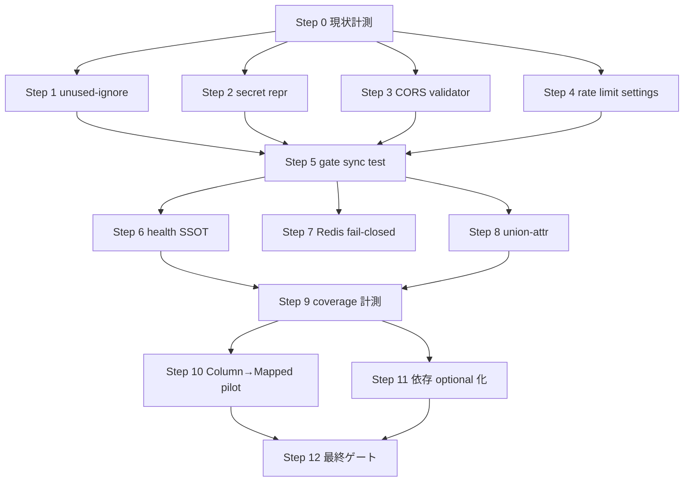

# PLAN_T1: コードレビュー改善提案の実装計画（12 STEPS）

> **目的**:
> 2026-11 のコードレビューで挙がった改善提案のうち、**既存の品質ゲート（ruff / mypy ratchet /
> coverage gate / OpenAPI snapshot / layer boundary check）を壊さずに実装できるもの**を
> 優先度・リスク・工数つきで実行可能な計画に落とす。
>
> **本計画の特徴**:
> 1. **1 ステップ = 1 コミット**。失敗したらそのステップだけ revert できる。
> 2. **ratchet を増やさない**。mypy / ruff / format の baseline は現状以下に保つ。
> 3. **スキーマ・API 形状の破壊的変更は避ける**。OpenAPI snapshot が変わる場合は
>    `make openapi` + `npm run type:sync` を必須化する。
> 4. **低リスクの Quick Win を先に、モデル改修や依存整理は段階的に** 行う。
>
> **対象ブランチ**: `feature/t1-review-improvements`
> **前提**: `main` が `make verify` および `make ci-parity` で green であること。

---

## 0. スコープと非スコープ

### 0.1 スコープ（本計画で扱う）

| 分類 | 提案 |
|---|---|
| 型安全性 | mypy unused-ignore 撤去 / `union-attr` の None ガード / Column→Mapped 移行 |
| セキュリティ | シークレット repr 対策 / CORS ワイルドカード判定の統合 / Redis fail-closed |
| 運用 | 認証レート制限の設定外部化 / ヘルスチェック SSOT 統合 / ゲートとドキュメントの同期テスト |
| 依存 | optional 依存の分離 + minimal-install スモークテスト |
| 計測 | レイヤ別カバレッジの現状計測 |

### 0.2 非スコープ（本計画では扱わない）

| 項目 | 理由 |
|---|---|
| NSFW のユーザー単位認可 | 認可モデル・DB スキーマ・UI に波及する**機能追加**であり、セキュリティ修正の PR として出すとレビューが破綻する。別計画で設計する。 |
| Stripe / Anthropic の即時 optional 化 | `billing_webhook` / Claude アダプタがモジュール直下 import しており、起動経路に密結合。まずは `ortools` / `Pillow` など影響の小さい依存から着手する。 |
| レイヤ別カバレッジゲートの即時導入 | 現状の実数が不明のため、いきなり `fail_under` を設定すると即赤になる可能性が高い。本計画では**計測のみ**を行い、閾値設定は次計画に委ねる。 |

---

## 1. メリット・デメリット早見表

| # | 提案 | メリット | デメリット | リスク | 判断 |
|---|---|---|---|---|---|
| 1 | mypy unused-ignore 撤去 | mypy baseline を実質的に減らせる。実害のある無視コメントを掃除できる。 | 216 件前後の機械的な編集が必要。 | 低 | **実施（Phase A）** |
| 2 | シークレット repr 対策 | `repr(settings)` / ログ経由の漏洩面を減らせる。 | `SecretStr` にすると accessor 更新が波及する。 | 低 | **実施（Phase A・`repr=False` に限定）** |
| 3 | CORS ワイルドカード判定の Settings 統合 | 起動時 fail-fast になり、app_factory と Settings の判定ズレを消せる。 | 既存の本番デプロイが wildcard を使っていた場合、起動しなくなる。 | 低〜中 | **実施（Phase A）** |
| 4 | 認証レート制限の設定外部化 | 運用環境ごとに閾値を調整できる。コード変更なしで tuning 可能。 | 設定追加により `.env.example` / README の保守コストが増える。 | 低 | **実施（Phase A）** |
| 5 | ゲートとドキュメントの同期テスト | baseline 値の README / Makefile / CI ワークフロー間の drift を防げる。 | 変更のたびに複数ファイルの同期が必要になる。 | 低 | **実施（Phase A）** |
| 6 | ヘルスチェック SSOT 統合 | `/health/*` 系の実装が分散している状態を解消できる。 | レスポンス形状を変えると docker healthcheck / OpenAPI が壊れる。 | 中 | **実施（Phase B・形状維持で統合）** |
| 7 | Redis fail-closed | Redis 障害時に revoked token / rate limit の fail-open を防げる。 | 可用性が下がる。運用ポリシーの合意が必要。 | 中 | **実施（Phase B・feature flag 付き）** |
| 8 | `union-attr` の None ガード | 実際のバグの温床を潰せる。 | 95 件前後あり、1 ステップで完結しない。 | 低〜中 | **実施（Phase B・バッチで）** |
| 9 | レイヤ別カバレッジ計測 | 手薄なレイヤを可視化できる。 | 計測だけでは gate にならない。 | 低 | **実施（Phase B・計測のみ）** |
| 10 | Column→Mapped 移行 | 型安全性が上がり、SQLAlchemy 2.0 流儀に揃う。 | `mapped_column` 置換で nullability / server_default 推論が変わる恐れ。alembic との整合確認が必須。 | 中〜高 | **実施（Phase C・pilot 1〜2 モデルのみ）** |
| 11 | 依存 optional 化 + minimal-install スモークテスト | インストールが軽くなり、起動が速くなる。 | モジュール直下 import を壊すと起動時に ImportError が出る。 | 中〜高 | **実施（Phase C・影響小の依存から）** |

---

## 2. 作業方針

| # | 原則 | 理由 |
|---|---|---|
| P1 | 1 ステップ = 1 コミット | revert 可能性を最優先する |
| P2 | 既存ゲートを壊さない | `make verify` / `make ci-parity` が green のまま維持する |
| P3 | baseline は増やさない | mypy / ruff / format の ratchet は現状以下に保つ |
| P4 | レスポンス形状・DB スキーマの破壊的変更はしない | OpenAPI snapshot / docker healthcheck / 既存 DB を保護する |
| P5 | 実測できない提案は「計測のみ」で止める | 誤った gate 導入を避ける |

---

## Phase A: Quick Win（Step 0〜5）

### Step 0: 現状計測と baseline の記録

**目的**: 後続ステップの効果を客観的に測れるようにする。

**変更**:
- コード変更はしない。
- 以下のコマンド結果を本計画書の「付録 A: 実測記録」に追記する。

```bash
.venv/bin/python -m mypy src --ignore-missing-imports
.venv/bin/python scripts/ci_lint_ratchet.py --tool all
.venv/bin/python -m pytest -q -m "not integration and not perf and not slow" --timeout=120 \
  --cov=src/domain --cov=src/application --cov-report=term
grep -rn "router.get(\"/health" src/backend/routers/health.py
```

**受け入れ基準**:
- mypy / ruff / format の現行値が記録されている。
- `src/domain` と `src/application` の coverage 実数が記録されている。
- `/health` 系エンドポイントの一覧が記録されている。

---

### Step 1: mypy unused-ignore の撤去

**目的**:
`warn_unused_ignores = true` のもとで不要になっている `# type: ignore` を撤去し、
mypy baseline を実質的に削減する。

**変更**:
1. `mypy` の `unused-ignore` 警告対象を抽出する。
2. 該当行の `# type: ignore` コメントのみを除去する（ロジックは変更しない）。
3. 撤去後に mypy を再実行し、**新規エラーが出た行だけ revert** する。

**手順**:
```bash
.venv/bin/python -m mypy src --ignore-missing-imports | grep "unused-ignore"
# 該当行の ignore コメントを撤去
.venv/bin/python -m mypy src --ignore-missing-imports
```

**検証**:
```bash
.venv/bin/python -m mypy src --ignore-missing-imports
.venv/bin/python scripts/ci_lint_ratchet.py --tool all
.venv/bin/python -m pytest -q -m "not integration and not perf and not slow" --timeout=120
```

**受け入れ基準**:
- `unused-ignore` が 0 件になる（または大幅に減る）。
- `mypy_errors` baseline が増えていない。
- README の baseline 行と `config/ci_lint_baseline.json` を同期している。

**デメリット**: 機械的な編集量が多い。ただしリスクは低い。

---

### Step 2: シークレット系フィールドの repr 対策

**目的**:
`repr(settings)` や誤ったログ出力によるシークレット漏洩面を減らす。

**変更**:
`src/infrastructure/config/settings.py` の以下のフィールドに `repr=False` を付与する。

- `JWT_SECRET_KEY`
- `STRIPE_SECRET_KEY`
- `STRIPE_WEBHOOK_SECRET`
- `OPENAI_API_KEY`
- `GEMINI_API_KEY`
- `ANTHROPIC_API_KEY`
- `OPENROUTER_API_KEY`
- `DALL_E_API_KEY`
- `ALLOWED_API_KEYS`

**やらないこと**:
- このステップでは `SecretStr` への型変更を行わない（accessor 更新が波及するため）。

**テスト**:
新規テスト `tests/regression/test_secret_repr.py` を追加する。

```python
def test_settings_repr_does_not_leak_secrets():
    settings = Settings(
        APP_ENV="testing",
        OPENAI_API_KEY="dummy-openai-key",
        ANTHROPIC_API_KEY="dummy-anthropic-key",
        JWT_SECRET_KEY="dummy-jwt-secret",
    )
    rendered = repr(settings)
    assert "dummy-openai-key" not in rendered
    assert "dummy-anthropic-key" not in rendered
    assert "dummy-jwt-secret" not in rendered
```

**検証**:
```bash
.venv/bin/python -m pytest tests/regression/test_secret_repr.py -q --timeout=120
```

**受け入れ基準**:
- 新規テストが green。
- 既存の Settings 関連テストがすべて green。

**デメリット**: なし（影響範囲が小さい）。

---

### Step 3: CORS ワイルドカード判定の Settings への統合

**目的**:
`CORS_ORIGINS` に `*` が含まれる場合の本番拒否を、`app_factory` の実行時チェックだけでなく
`Settings.validate_production_secrets` にも追加し、判定を一本化する。

**変更**:
`src/infrastructure/config/settings.py` の `validate_production_secrets` に以下を追加する。

```python
if "*" in [o.strip() for o in self.CORS_ORIGINS.split(",")]:
    raise ValueError(
        "本番環境 (APP_ENV=production) では CORS_ORIGINS に '*' を設定できません。"
        "公開オリジンを明示的に列挙してください。"
    )
```

`src/interfaces/api/app_factory.py` 側の既存チェックは縦深防御として**残す**。

**テスト**:
- 本番 + `CORS_ORIGINS="*"` で `ValueError` が raise されること。
- 開発 + `CORS_ORIGINS="*"` では raise されないこと。

**検証**:
```bash
.venv/bin/python -m pytest tests/regression -q -k "settings or cors" --timeout=120
```

**受け入れ基準**:
- 新規テストが green。
- 既存の本番環境テストが壊れない。

**デメリット**: wildcard を使っている既存の本番構成は起動しなくなる。事前に `docker-compose.prod.yml` の利用形態を確認すること。

---

### Step 4: 認証系レート制限の設定外部化

**目的**:
`app_factory.py` にハードコードされている `/api/auth/*` のレート制限値を設定に移す。

**変更**:
1. `src/infrastructure/config/settings.py` に以下を追加する。

```python
AUTH_RATE_LIMIT_LOGIN: int = 10
AUTH_RATE_LIMIT_REGISTER: int = 5
AUTH_RATE_LIMIT_REFRESH: int = 30
```

2. `src/interfaces/api/app_factory.py` の `AUTH_PATH_RATE_LIMITS` を settings 参照に置き換える。

**テスト**:
- 既定値のとき挙動が変わらないこと。
- settings を上書きしたときミドルウェアに渡る値が変わること。

**検証**:
```bash
.venv/bin/python -m pytest tests/unit -q -k "rate_limit or app_factory" --timeout=120
```

**受け入れ基準**:
- 既定値での挙動が変更前と同一。
- `.env.example` と README の環境変数表に新項目を追記。

**デメリット**: 設定項目が 3 つ増える。ドキュメント同期が必要。

---

### Step 5: ゲートとドキュメントの同期テスト

**目的**:
baseline 値の README / `Makefile` / CI workflow 間の drift をテストで検出できるようにする。

**変更**:
`tests/regression/test_lint_baseline_integrity.py` を拡張し、以下を検証する。

1. `config/ci_lint_baseline.json` の `mypy_errors` と README の baseline 行が一致する。
2. `Makefile` の `MYPY_PIN_VERSION` と `.github/workflows/ci.yml` の mypy pin が一致する。
3. `pyproject.toml` の `fail_under` と README のカバレッジ記載が一致する。

**検証**:
```bash
.venv/bin/python -m pytest tests/regression/test_lint_baseline_integrity.py -q --timeout=120
```

**受け入れ基準**:
- 意図的に 1 つだけ値をずらすとテストが赤になることを確認済み。
- 通常状態では green。

**デメリット**: baseline 更新時の作業が 1 ファイル増える。ただし drift 防止の効果が上回る。

---

## Phase B: 設計を伴う中規模（Step 6〜9）

### Step 6: ヘルスチェックの SSOT 統合（形状維持）

**目的**:
`/health` 系の実装が `observability/health.py` と `health/checks.py` に分散している状態を解消する。

**方針**:
- **レスポンス形状は変更しない**。docker healthcheck と OpenAPI snapshot を保護する。
- `src/backend/health/checks.py` を疎通確認の SSOT とし、
  `src/backend/observability/health.py` はその薄い adapter にする。

**変更**:
1. `observability/health.py` の `check_database` / `check_huey` が
   `health/checks.py` の primitive を利用するように修正する。
2. `src/backend/routers/health.py` も同一の primitive を参照するように修正する。
3. `/health/live` と `/health/liveness` は同一ハンドラの alias のまま維持する。

**テスト**:
- `/health/live` と `/health/liveness` が同一レスポンス形状を返すこと。
- `/health/ready` は DB 疎通のみ、`/health/readiness` は DB + Redis を見ることを契約テスト化する。

**検証**:
```bash
.venv/bin/python -m pytest tests/contract -q -k "health" --timeout=120
.venv/bin/python -m pytest tests/unit -q -k "health" --timeout=120
```

**受け入れ基準**:
- 既存の health 関連テストがすべて green。
- OpenAPI snapshot が不要に変わらない（変わった場合は `make openapi` + `npm run type:sync`）。

**デメリット**: 既存の health テストとの整合確認に時間がかかる可能性がある。

---

### Step 7: Redis fail-closed の導入（feature flag 付き）

**目的**:
Redis 障害時に token denylist / rate limiter が fail-open になる問題に対し、
本番では fail-closed を選べるようにする。

**方針**:
- 既定は現行どおり fail-open（開発環境の利便性を維持）。
- 本番では `REDIS_FAIL_OPEN=False` を強制するバリデータを追加。

**変更**:
1. `src/infrastructure/config/settings.py` に `REDIS_FAIL_OPEN: bool = True` を追加。
2. 本番バリデータで `REDIS_FAIL_OPEN=True` を拒否する。
3. `src/backend/rate_limit.py` と `src/backend/security/token_denylist.py` に
   fail-closed 分岐を追加する。

**テスト**:
- Redis 障害シミュレーション時、`REDIS_FAIL_OPEN=True` では現行どおり動くこと。
- `REDIS_FAIL_OPEN=False` では 503 / 拒否になること。

**検証**:
```bash
.venv/bin/python -m pytest tests/unit -q -k "rate_limit or denylist" --timeout=120
.venv/bin/python -m pytest tests/security -q --timeout=120
```

**受け入れ基準**:
- 本番構成で `REDIS_FAIL_OPEN=True` だと起動しない。
- 開発構成は現行どおり fail-open で動く。

**デメリット**: 可用性が下がる。運用ポリシーの合意が前提。

---

### Step 8: `union-attr` の None ガード（バッチ処理）

**目的**:
mypy の `union-attr` 系エラーを実際の None ガード追加で解消する。

**方針**:
- 1 バッチ 10〜20 件ずつ。全部を 1 コミットに入れない。
- `# type: ignore` の追加は**禁止**（恒真アサート / grep ベース assert と同様に形だけの解消を避ける）。

**手順**:
```bash
.venv/bin/python -m mypy src --ignore-missing-imports | grep "union-attr"
```

**検証**:
```bash
.venv/bin/python -m mypy src --ignore-missing-imports
.venv/bin/python -m pytest -q -m "not integration and not perf and not slow" --timeout=120
```

**受け入れ基準**:
- 修正バッチごとに mypy baseline が減っている。
- 新たな `# type: ignore` を追加していない。

**デメリット**: 時間がかかる。ただし実バグを発見できる可能性が高い。

---

### Step 9: レイヤ別カバレッジの現状計測

**目的**:
`src/domain` / `src/application` の coverage 実数を把握し、次計画の閾値決定の材料にする。

**変更**:
- コード変更はしない。
- 計測結果を本計画書の「付録 A」に追記する。

```bash
.venv/bin/python -m pytest -q -m "not integration and not perf and not slow" --timeout=120 \
  --cov=src/domain --cov=src/application --cov-report=term
```

**受け入れ基準**:
- レイヤ別の実数が記録されている。
- 閾値の提案（次計画用）がコメントとして残されている。

**デメリット**: gate にはならない。あくまで計測。

---

## Phase C: 段階導入（Step 10〜12）

### Step 10: Column→Mapped 移行の pilot

**目的**:
旧 `Column(...)` スタイルのモデルを SQLAlchemy 2.0 の `Mapped[...]` / `mapped_column()` に移行する第一歩を踏む。

**方針**:
- **1〜2 モデルのみ**を pilot 対象とする。
- 影響の小さいテーブルから始める（例: `entertainment_check_log.py`, `setting_delta.py`）。

**手順**:
1. 対象モデルを `mapped_column` ベースに書き換える。
2. `alembic check` でスキーマ差分がないことを確認する。
3. `make test-migration` を実行する。

```bash
alembic check
make test-migration
```

**受け入れ基準**:
- `alembic check` が差分なし。
- 対象モデルのテストが green。
- mypy baseline が増えていない。

**デメリット**: 全モデルに展開するには数週間かかる。本ステップでは完結しない。

---

### Step 11: 依存 optional 化（影響の小さいものから）

**目的**:
起動に必須でない重い依存を optional にし、インストールを軽くする。

**対象**:
- `ortools`（CSP バランサ）
- `Pillow`（漫画 / 挿絵）

**方針**:
- `pyproject.toml` に `[project.optional-dependencies]` へ移動。
- モジュール内 import は遅延化し、未インストール時は分かるエラーを出す。

```python
try:
    from ortools.sat.python import cp_model
except ImportError as e:
    raise RuntimeError(
        "CSP バランサには 'csp' extra が必要です: pip install -e '.[csp]'"
    ) from e
```

**テスト**:
- 未インストール環境で該当機能を呼ぶと RuntimeError になること。
- `pip install -e .` のみで `src.interfaces.api.app_factory` が import できること。

```bash
pip install -e .
python -c "from src.interfaces.api.app_factory import create_app; print('ok')"
```

**受け入れ基準**:
- minimal-install でアプリの import が成功する。
- 既存テスト（ortools / Pillow を使うテスト）は skip ではなく green を維持。

**デメリット**: 未インストール時に初めて気づくエラーになる。エラーメッセージの整備が必須。

---

### Step 12: 最終ゲートとドキュメント同期

**目的**:
本計画の全ステップが既存ゲートを壊していないことを確認し、ドキュメントを同期する。

**手順**:
```bash
# 静的解析
.venv/bin/python -m ruff check src tests config scripts
.venv/bin/python -m ruff format --check src tests config scripts
.venv/bin/python -m mypy src --ignore-missing-imports
.venv/bin/python scripts/ci_lint_ratchet.py --tool all
.venv/bin/python scripts/check_layer_boundaries.py

# テスト
.venv/bin/python -m pytest -q -m "not integration and not perf and not slow" --timeout=120
.venv/bin/python -m pytest tests/contract -q --timeout=120
.venv/bin/python -m pytest tests/security -q --timeout=120

# マイグレーション
make test-migration

# OpenAPI / フロントエンド型
make openapi
cd frontend && npm run type:sync && cd ..
```

**受け入れ基準**:
1. `make verify` が green。
2. mypy / ruff / format baseline が増えていない。
3. README / `.env.example` / `config/ci_lint_baseline.json` の整合が取れている。
4. OpenAPI snapshot と frontend 型が同期されている。

---

## 3. 実行順序と依存関係



---

## 4. リスクと緩和策

| リスク | 影響 | 緩和策 |
|---|---|---|
| unused-ignore 撤去後に mypy エラーが増える | baseline 超過 → CI 赤 | 該当行のみ revert し、段階的に撤去する |
| CORS validator により既存本番が起動しない | デプロイ停止 | 事前に本番構成の `CORS_ORIGINS` を確認し、wildcard 利用なら先に修正する |
| Redis fail-closed により可用性が下がる | 本番障害時の UX 悪化 | feature flag で開発環境は fail-open を維持し、本番のみ fail-closed にする |
| Column→Mapped で alembic 差分が出る | マイグレーション破壊 | pilot は 1〜2 モデルに限定し、差分が出たら即中断して記録する |
| 依存 optional 化で起動が壊れる | 起動不能 | minimal-install スモークテストを CI に入れ、起動可否を機械検証する |

---

## 5. 完了条件

1. Phase A〜C の全ステップがコミット済み。
2. `make verify` が green。
3. mypy / ruff / format baseline が増加していない。
4. 本計画書の「付録 A」に before / after の実測が記録されている。
5. 本計画で扱わなかった提案（NSFW 認可、Stripe / Anthropic optional 化、レイヤ別カバレッジ gate）は
   別計画として起票されている。

---

## 付録 A: 実測記録（Step 0 で埋める）

| 項目 | before | after |
|---|---|---|
| mypy errors（total） | TBD | TBD |
| unused-ignore errors | TBD | TBD |
| ruff errors | TBD | TBD |
| format errors | TBD | TBD |
| `src/domain` coverage | TBD | TBD |
| `src/application` coverage | TBD | TBD |
| health endpoints | TBD | TBD |
